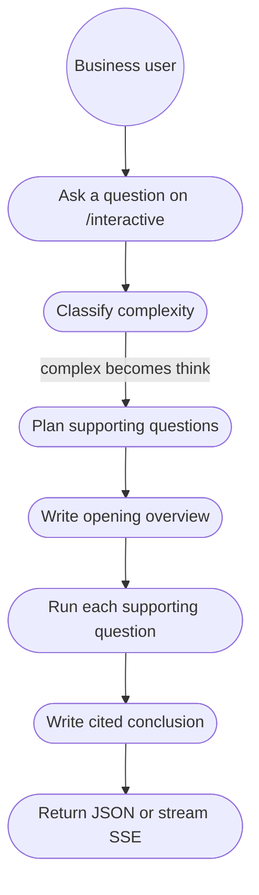
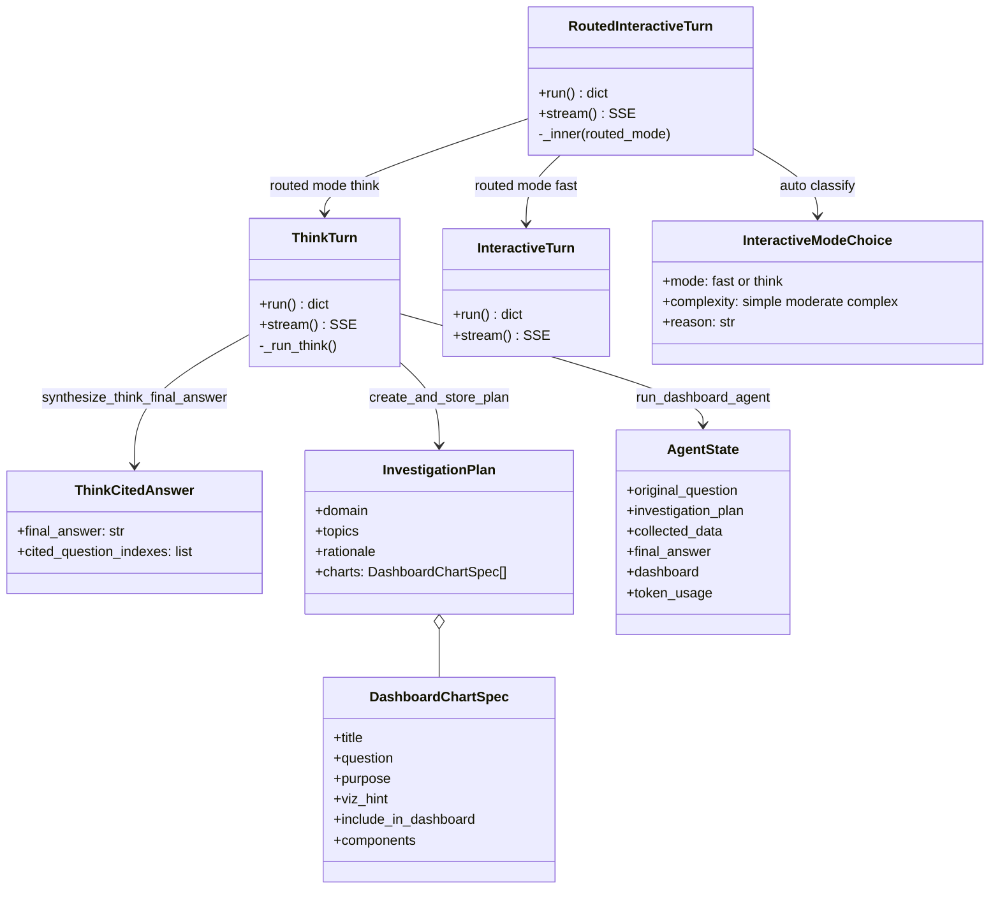
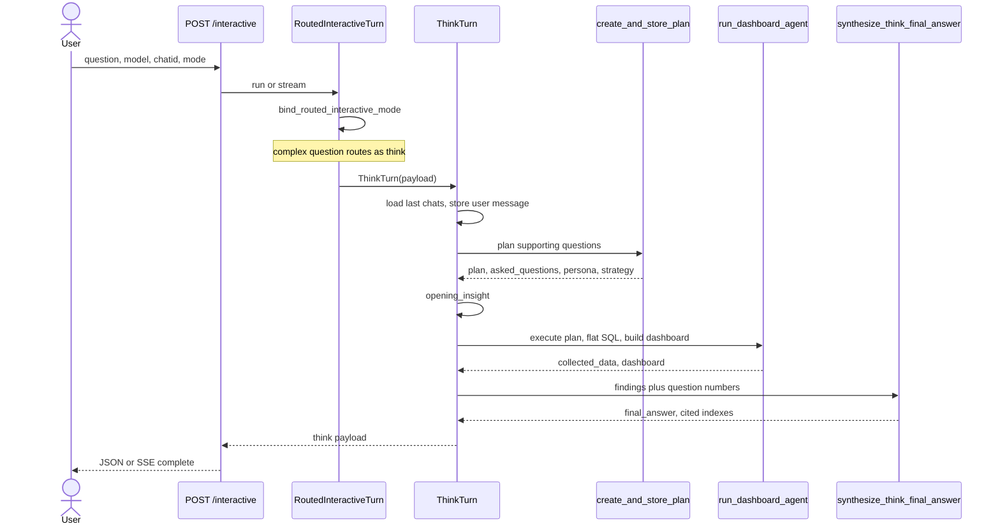
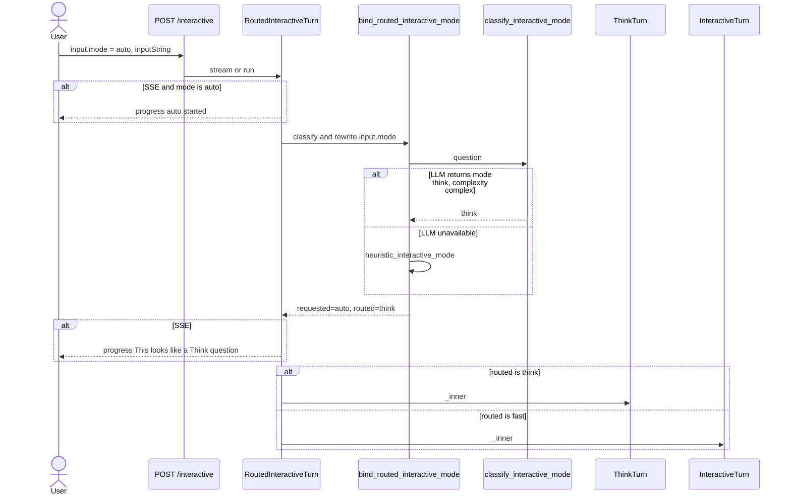
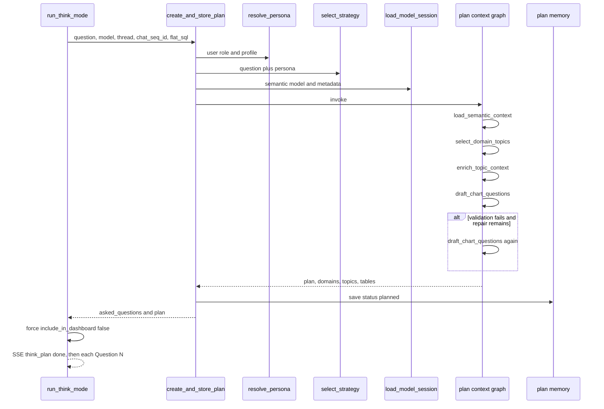
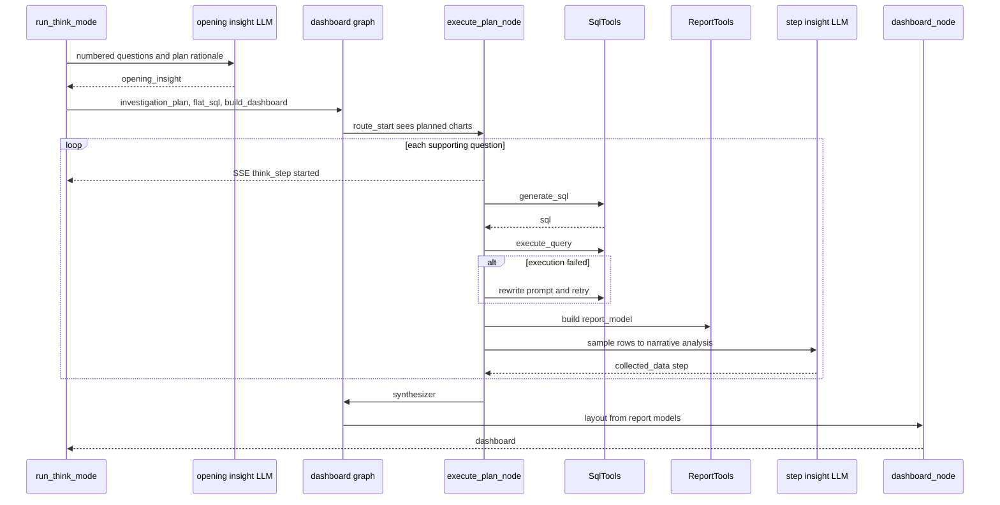
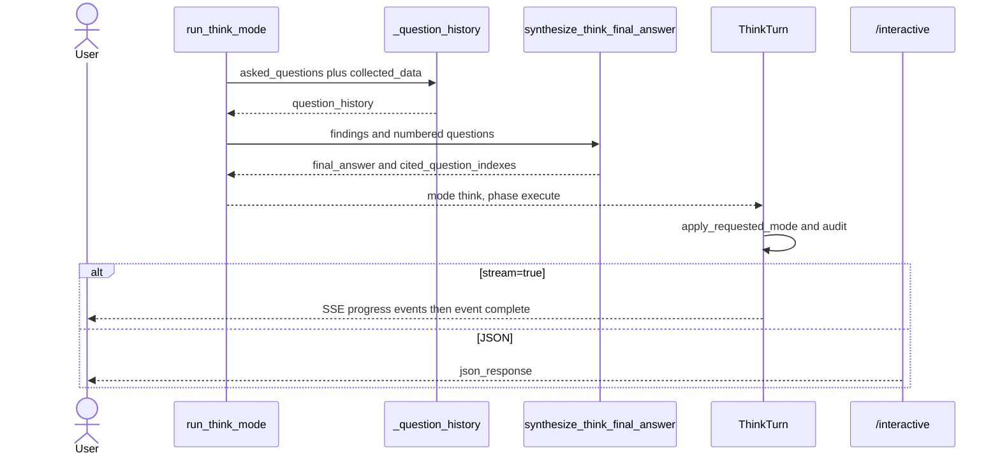

# Interactive chat — complex question flow

A complex question on `POST /interactive` is the **Think** path. The classifier records complexity as `simple`, `moderate`, or `complex`, and a complex question is routed as mode `think`. That path plans several supporting questions, runs each one for text findings, then returns an opening overview and a cited conclusion.

The Fast path (one SQL query and a chart) is described in [INTERACTIVE_FLOW.md](INTERACTIVE_FLOW.md).

Code: [`helicalbi/controller/interactive.py`](../helicalbi/controller/interactive.py), [`helicalbi/interactive/auto_mode.py`](../helicalbi/interactive/auto_mode.py), [`helicalbi/interactive/think_flow.py`](../helicalbi/interactive/think_flow.py).

**Jump between diagrams**

| | Diagram | What it shows |
|---|---|---|
| 1 | [Use cases](#usecase) | Who does what, from the question to the final payload |
| 2 | [Classes](#classes) | Which objects own each step |
| 3 | [End-to-end sequence](#seq-overview) | One request, collapsed |
| 4 | [Classify](#seq-classify) | How “complex” becomes Think |
| 5 | [Plan](#seq-plan) | Supporting questions |
| 6 | [Execute one question](#seq-execute) | SQL, findings, report model |
| 7 | [Final output](#seq-final) | Overview, conclusion, JSON or SSE |

---

## 1. Overview

The user posts a question to `POST /interactive` with `input.inputString`, a semantic model (`input.model.file` / `dir`), `chatid`, and `chat_seq_id`. Mode is `input.mode`: `fast`, `think`, or `auto` (aliases such as `deep`, `agent`, and `research` mean Think).

When the mode is `auto`, an LLM (`InteractiveModeChoice`) labels the question. **Complex** means mode `think`. If that call fails, a heuristic does the same job: “why”, “compare”, “root cause”, “recommend”, a long question, or more than one question mark all go to Think.

Think then does four things, in order:

1. **Plan** supporting questions from the semantic model, persona, and strategy.
2. **Write a short overview** from that plan, before any SQL runs.
3. **Execute each supporting question** as flat SQL and a text finding. Charts are kept off the client (`include_in_dashboard` is false). A report model is still built so Preview and Metrics work, and a dashboard layout is still produced.
4. **Write the conclusion** with inline citations such as `[1]`, `[2]` that point at those supporting questions.

The client receives `opening_insight`, `question_history`, `final_answer`, `cited_question_indexes`, `plan`, and `dashboard`. `chat_responses` is empty, so the UI shows text findings, not a chart gallery.

### Use case diagram

Next: [class diagram](#classes) · [end-to-end sequence](#seq-overview)

---

## 2. High level

`RoutedInteractiveTurn` is the front door for both JSON and SSE. It calls `bind_routed_interactive_mode`. If the routed mode is `think`, it builds a `ThinkTurn`. `ThinkTurn` calls `run_think_mode`, which is the complex pipeline:

`create_and_store_plan` → opening insight → `run_dashboard_agent` → cited conclusion.

Inside the dashboard agent, a stored plan skips the free-form planner. The graph starts at `execute_plan`, then `synthesizer`, then `dashboard`. The text the user sees as the conclusion is written afterward by `synthesize_think_final_answer`. The synthesizer text is kept only if that cited draft is empty.

### Class diagram

### End-to-end sequence

Drill in: [how complex is chosen](#seq-classify) · [how the plan is built](#seq-plan) · [how one question runs](#seq-execute) · [how the payload is closed](#seq-final)

---

## 3. Detail

### 3.1 From the request to Think

`resolve_interactive_mode_from_input` reads `input.mode`, then `input.interactive_mode`, then the top-level `mode`. Default is `fast`.

| Requested mode | What runs |
|---|---|
| `think`, `deep`, `agent`, `research`, `plan` | Think immediately. No classifier. |
| `fast`, `quick`, `normal` | Fast path (`InteractiveTurn` / `run_fast_mode`). |
| `auto`, `automatic`, `smart` | Classifier, then Fast or Think. |

For `auto`, `classify_interactive_mode` asks the agent LLM with `AUTO_MODE_PROMPT` and parses `InteractiveModeChoice`. The route uses `mode`. A complex question comes back as `mode=think` with `complexity=complex`. On failure, `heuristic_interactive_mode` applies the same split. `bind_routed_interactive_mode` then rewrites `input.mode` to `think` and stores `input.requested_mode=auto`, so the response can still say the user asked for Auto.

On a stream, the client first sees: “Checking how complex this question is…”, then “This looks like a Think question. Using Think mode.”

Back to [use cases](#usecase) · Next: [plan](#seq-plan)

### 3.2 Plan the investigation

`ThinkTurn._run_think` registers cancellation, loads the last chat turns, stores the user message, and calls `run_think_mode`.

`create_and_store_plan` prepares context, then runs the plan graph:

1. `resolve_mode_profile` from `agent_mode` (default `balanced`) and the chart ceiling `dashboard_max_sub_questions`.
2. `resolve_persona` from role and profile, then `select_strategy` from an explicit hint or the strategy decision tree.
3. `load_model_session` loads the semantic model, metadata, schema index, and semantic index.
4. `run_plan_context_graph` walks five nodes. `validate_questions` can send the draft back to `draft_chart_questions` once for repair.
5. The public plan (domain, topics, rationale, charts) is saved in plan memory with status `planned`.

Think then copies that plan through `_text_only_plan`, which sets every chart’s `include_in_dashboard` to false, and calls SQL generation with `flat_sql=true`.

Each chart on the plan is a `DashboardChartSpec`: title, sub-question, purpose, viz hint, topic, components, and measure hints.

Back to [classes](#classes) · Next: [execute one question](#seq-execute)

### 3.3 Execute each supporting question

Before SQL, `synthesize_think_opening_insight` fills `think_success_prompt_formatted` with the user question, the numbered plan, and domain/topic/table metadata. That string becomes `opening_insight`. If it fails, the run continues with an empty overview.

`run_dashboard_agent` loads the model session again, seeds `AgentState` with the text-only plan, and invokes the dashboard graph. `route_start` sees planned charts and goes to `execute_plan` (the free-form planner is for questions that have no stored plan).

For every chart, `execute_plan_node`:

1. Retrieves semantic scope, then keeps the plan’s domains and topics.
2. Generates SQL for that sub-question (`flat_sql`).
3. Executes it. On failure it rewrites the prompt from the engine error and retries, up to `SQL_RETRY_MAX`.
4. Because the chart is text-only, it builds a report model (`report_tools.build`) and a step insight (`_llm_step_insight` plus `apply_sql_success_insight`). The step is stored in `collected_data` with `include_in_dashboard=false`.
5. If the report build fails, it falls back to `analysis_tools.analyze` on the query result.
6. Emits SSE `think_step` (“Analyzing question N: …”).

After the last chart the graph runs `synthesizer_node`, then `dashboard_node`, which lays out report models for the Dashboard Model tab. Plan memory is updated to status `executed`.

`_question_history` then lines up plan charts with `collected_data`. Each row has index, question, title, purpose, metrics, dimensions, analysis text, `chat_seq_id`, `chat_response`, and `report_model`. Empty metric lists on the SQL section are filled from the plan chart so the Metrics UI is not blank.

Back to [plan](#seq-plan) · Next: [final output](#seq-final)

### 3.4 Conclusion and what the client gets

`synthesize_think_final_answer` sends the original question, the numbered supporting questions, the findings block, and the plan rationale to the agent LLM. The model returns `ThinkCitedAnswer`: markdown (`**bold**` figures, optional bullets, about 80–180 words) and `cited_question_indexes`. Indexes are kept only when they match a real question number. If the model omits the list, indexes are read from `[n]` markers in the prose. If the draft is empty, a short fallback is built from the findings.

Token usage from the plan, the opening insight, and the dashboard run are added together. `apply_requested_mode` puts `requested_mode=auto` back on the body when the user started in Auto. `audit_llm_usage_async` records the `/interactive` call.

**Final payload (complex / Think)**

| Field | Meaning |
|---|---|
| `mode` | `think` |
| `requested_mode` | `auto` when the user asked for Auto |
| `phase` | `execute` |
| `opening_insight` | Short overview written from the plan |
| `asked_questions` | Supporting questions, in plan order |
| `question_history` | One finding per question, with analysis and report model |
| `final_answer` | Cited conclusion |
| `cited_question_indexes` | 1-based indexes used in that conclusion |
| `plan` | Domain, topics, rationale, charts |
| `dashboard` / `dashboard_model` | Layout built from report models |
| `chat_responses` | Always `[]` on this path |
| `persona`, `strategy`, `token_usage` | Routing context and usage |
| `llm_activity_details` | Present only when activity details are enabled |

SSE stages, in order: `auto` (only for Auto), `think_plan`, `think_intro`, `think_question` for each planned question, `think_execute`, `think_step` for each execution, `think_answer`, then `complete`.

[Map](#map) · [Use cases](#usecase) · [Classes](#classes) · [End to end](#seq-overview)
