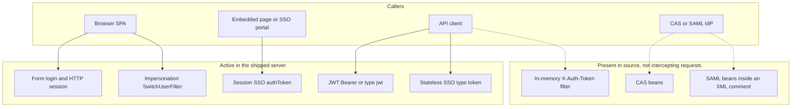
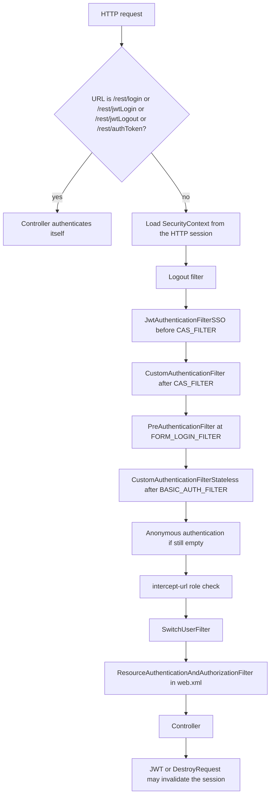
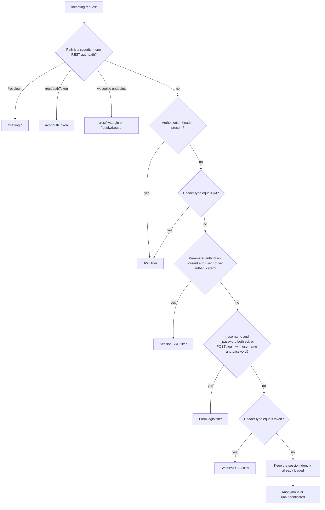
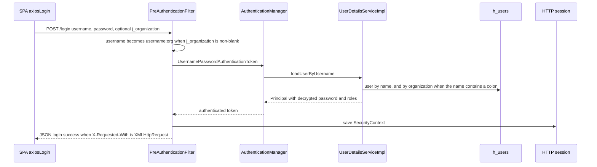
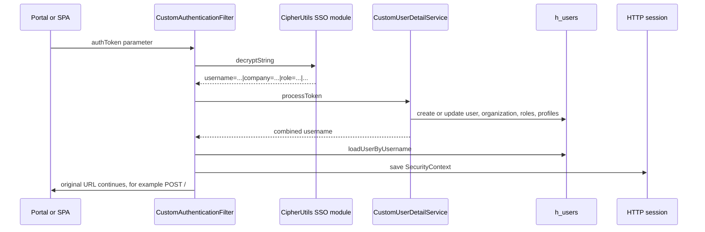
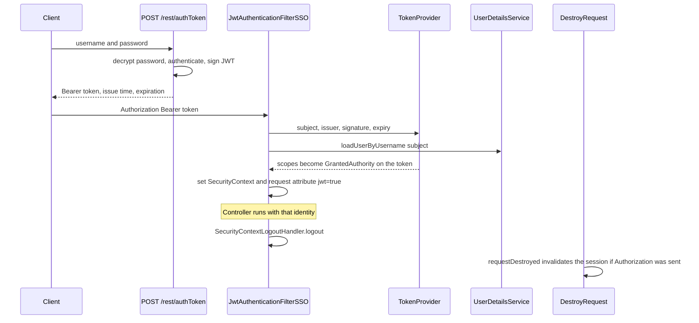
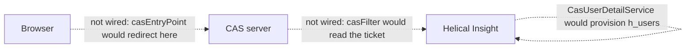
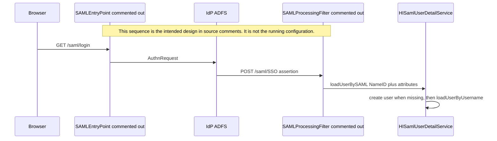
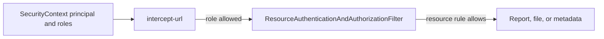
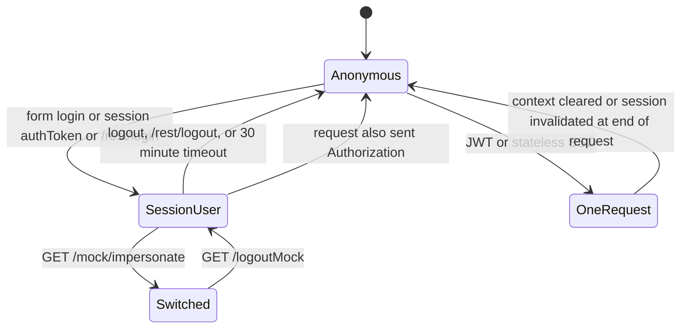

# Authentication Guide

Onboarding guide for engineers who need to trace a login, add an endpoint, or change SSO, JWT, CAS, or SAML behavior.

This document was written from the implementation in this repository. Login flows were not executed as part of writing it. Where a class exists but is not placed on the servlet filter chain, that status is called out explicitly.

## How to read this

If you are new to the team, read the sections in this order:

1. [What “logged in” means here](#what-logged-in-means-here) — users, organizations, roles, and the security context.
2. [What actually runs](#what-actually-runs) — the status of every mechanism.
3. [Request pipeline](#request-pipeline) — the filter order for one HTTP request.
4. [Which mechanism handles this request?](#which-mechanism-handles-this-request) — the decision flowchart.
5. The active mechanisms, in the order a request meets them: [JWT](#4-jwt-bearer-tokens), [session SSO `authToken`](#2-session-sso-authtoken), [form login](#1-form-login-and-http-session), [stateless SSO](#3-stateless-sso-token).
6. [URL authorization](#url-authorization-is-not-authentication) before you add a controller.
7. The dormant mechanisms ([CAS](#6-cas), [SAML](#7-saml--adfs), [in-memory REST token](#8-in-memory-x-auth-token), [unused classes](#classes-that-are-easy-to-wire-by-mistake)) so you do not turn one on by accident.

Related reading: [Base URL, nginx, and forwarded headers](baseurl-config-document-engineer.md). Login redirects and absolute links depend on that configuration.

## Overview and scope

Helical Insight authenticates a person, then authorizes URLs and repository resources separately.

Authentication answers “who is this caller?” and stores the answer in Spring Security’s `SecurityContext`. Authorization answers “may this caller open this URL or this report?” and is a later step.

The product ships with more than one way to establish that identity:

| Mechanism | Status in the shipped configuration | Session after the request |
|-----------|--------------------------------------|---------------------------|
| Form login (`POST /login`) | Active | HTTP session (`JSESSIONID`) |
| Session SSO `authToken` (query or body) | Active | HTTP session |
| Stateless SSO (`type: token` header) | Active | Context cleared after the request |
| JWT (`Authorization: Bearer` or `type: jwt`) | Active | Session invalidated when the request ends |
| `POST /rest/authToken`, `/rest/jwtLogin`, `/rest/jwtLogout` | Active, and excluded from the security filter chain | Token or cookie only; these URLs are `security="none"` |
| `GET` or `POST /rest/login` | Active, `security="none"`; creates a session itself | HTTP session |
| User impersonation (`/mock/impersonate`, `/logoutMock`) | Active | Replaces the session principal |
| CAS | Provider is registered. Browser filter and entry point are not on the chain | Would be a session if the filter were enabled |
| SAML / ADFS | Java code exists. The Spring beans are inside an XML comment | Not active |
| In-memory `X-Auth-Token` | Classes and a `tokenManager` bean exist. The filter is not on the chain | Not active |
| `RequestParameterAuthenticationFilter` | Bean exists. Not on the chain | Not active |
| `CustomAuthenticationProvider` | Class exists. Not registered | Do not register it. See [below](#classes-that-are-easy-to-wire-by-mistake) |

**Intended consumers:** backend engineers changing `spring-security.xml`, SSO, JWT, or user provisioning, and frontend engineers changing `client/src/base/service.js`.

**Non-goals:** this guide does not document report, metadata, or datasource security rules beyond the point where they sit relative to login. Those rules run in `ResourceAuthenticationAndAuthorizationFilter` after the security chain.

## What “logged in” means here

### Identity

A user row lives in `h_users` (`com.helicalinsight.admin.model.User`).

The string Spring Security uses as the username is one of:

- `username` when the user has no organization
- `username:organizationName` when the user belongs to an organization

`UserDetailsServiceImpl.loadUserByUsername` splits on the first `:`, loads the organization, then loads the user in that organization. A missing organization throws `AuthenticationException` (“The organization does not exists”). A missing user throws `UsernameNotFoundException`.

The object stored as the principal is `com.helicalinsight.admin.model.Principal`. It extends Spring’s `User` and also carries profile rows, the organization name, and the persistent `User`.

### Roles

Role names are strings stored on the user and copied into `GrantedAuthority`. The built-in names are set in `ApplicationDefaultUserAndRoleNamesConfigurer`:

| Role | Typical use in `intercept-url` |
|------|--------------------------------|
| `ROLE_ADMIN` | Administration, metadata, datasource creation |
| `ROLE_USER` | Create and edit reports |
| `ROLE_VIEWER` | Open reports and dashboards |

`intercept-url` patterns also mention `ROLE_DOWNLOAD` and `ROLE_PREVIOUS_ADMINISTRATOR` (impersonation). Those are ordinary role names; they are not hard-coded in the configurer above.

External logins (SSO token, CAS, SAML) create the user, organization, and roles on the fly when they are missing, and set `isExternallyAuthenticated` to true. New SSO and CAS users are stored with an empty password. They are not password accounts.

### Where the identity is stored

`SecurityContextHolder` is set to `MODE_INHERITABLETHREADLOCAL` in `spring-security.xml`. A child thread inherits the caller’s authentication. Report and export code that starts worker threads depends on this.

The context is saved in the HTTP session by `HttpSessionSecurityContextRepository`. The session timeout in `web.xml` is **30 minutes**.

`authentication-manager` sets `erase-credentials="false"`, so the `Authentication` object keeps the password that was presented. Do not log `Authentication.getCredentials()`.

### Password storage

Passwords in `h_users.password` are ciphertext, not hashes.

| Step | Code | Cipher module |
|------|------|----------------|
| Save a user (`AdminController`, default users) | `CipherUtils.encrypt` | default (`cipherAlgorithm`, `cipherMode`, `cipherPadding`, `cipherKey` in `project.properties`) |
| Load a user for login | `CipherUtils.decrypt` inside `UserDetailsServiceImpl` | default |
| Compare with the submitted password | `NoOpPasswordEncoder` | none — equality check on the decrypted value |

`InternalDaoAuthenticationProvider` and the first `<authentication-provider user-service-ref="userDetailsService">` both do this check. They are registered in that order. A `UsernamePasswordAuthenticationToken` is accepted by both; a bad password is tried against the next provider. `CasAuthenticationProvider` only supports CAS tickets, so it does not handle form login.

SSO `authToken` decryption uses a different module: `CipherUtils.decryptString` calls `CipherUtils.MODULE_SSO` (`sso.cipherKey`, with the same algorithm family as the default module unless overridden). Treat `cipherKey` and `sso.cipherKey` as independent when you rotate secrets. Do not copy key values into tickets, logs, or new documents.

`CipherUtils.decrypt` returns the original string when the ciphertext has an illegal block size. A caller that decrypts before login can therefore pass a plaintext password through. `decryptString` (SSO tokens) throws `AuthenticationException("Invalid Token")` instead.

## What actually runs

Configuration file: `server/presentation/src/main/resources/spring-security.xml`.

Servlet entry: `DelegatingFilterProxy` named `springSecurityFilterChain`, mapped to `/*` in `server/presentation/src/main/webapp/WEB-INF/web.xml`. It runs after `ForwardedHeaderFilter`, the encoding filter, `responseMetadataFilter`, and Tomcat’s `CorsFilter`, and before `resourceAuthenticationFilter`.

Four paths never enter that chain (`<http security="none">`):

- `/rest/login`
- `/rest/jwtLogin`
- `/rest/jwtLogout`
- `/rest/authToken`

Those controllers perform their own authentication. Every other URL enters the chain described next.



## Request pipeline

`auto-config` is false. CSRF is disabled. The authentication entry point is `LoginUrlAuthenticationEntryPoint` for `/login` (not the CAS or SAML entry point).

For a URL that is not in the `security="none"` list, filters that decide identity run in this order. Positions are the Spring Security slots declared on each `<custom-filter>`.



Static files are skipped by the JWT and stateless filters (`shouldNotFilter`): `/favicon.ico`, `/js/**`, `/css/**`, `/images/**`, `/fonts/**`.

`session-management` is `migrateSession`. The composite session strategy actually registered only contains `ChangeSessionIdAuthenticationStrategy`. Beans for concurrent-session control and an extra fixation strategy exist and are **not** in that composite, so concurrent-session limits are not applied.

## Which mechanism handles this request?

The first matching rule wins. Later filters skip the request when `SecurityContext` already holds an authenticated user (the form-login filter has an extra exception, noted under form login).



CORS on `/*` allows the headers `authorization`, `authToken`, and `type` (`web.xml`). Browsers can send the JWT and SSO headers on cross-origin calls. `cors.allowed.origins` is `*`.

## 1. Form login and HTTP session

This is the normal product login. The SPA posts it from `axiosLogin` in `client/src/base/service.js`.

| Item | Verified value |
|------|----------------|
| Filter | `PreAuthenticationFilter` (`authenticationProcessingFilter`) |
| Position | `FORM_LOGIN_FILTER` |
| Client call | `POST /login` with `application/x-www-form-urlencoded` |
| Fields the SPA sends | `username`, `password`, and `j_organization` when an organization was typed |
| Also accepted | `j_username` and `j_password` on **any** URL |
| Success, browser | Redirect to the saved request, or `/welcome` |
| Success, Ajax (`X-Requested-With: XMLHttpRequest`) | HTTP 200 JSON `{"status":"1","message":"Login success"}` |
| Failure, Ajax | HTTP 401 JSON `{"status":"0","message":"Login Failed...."}` |
| Failure, browser | Redirect to `/loginFailed` |
| Entry point when a protected URL is anonymous | Redirect to `/login` |

`postOnly` is false. The stock matcher is still `POST /login`. The override in `requiresAuthentication` is what makes `j_username` plus `j_password` authenticate on other URLs and methods. The comparison `username != ""` uses reference equality, so a newly built empty string still counts as present. Do not “clean this up” without retesting embedded login links.

Organization handling:



`obtainPassword` prefers `j_password`, then the parameter `password`. The submitted value is plaintext. The database value is decrypted before `NoOpPasswordEncoder` compares them.

`PreAuthenticationFilter.attemptAuthentication` logs the `username` and `password` request parameters at debug. Leave that logger off in shared environments.

If a non-anonymous authentication is already in the context, this filter returns it and does not check the password again.

### Session login outside the filter chain

`com.helicalinsight.externalauth.rest.RestController` maps `GET` and `POST /rest/login`. That URL is `security="none"`. The method builds a `PreAuthenticationFilter`, calls `attemptAuthentication`, then returns the new `JSESSIONID` plus `sessionExpiry` (now + `session.getMaxInactiveInterval()` in milliseconds). Failure returns the 500 helper from `JsonUtils.get500ErrorResponse`.

`GET` or `POST /rest/logout` requires an authenticated session (`intercept-url`) and calls `session.invalidate()`.

## 2. Session SSO authToken

Use this when an external portal sends the user into Helical Insight with a single encrypted token and the user should **stay logged in**.

| Item | Verified value |
|------|----------------|
| Filter | `CustomAuthenticationFilter` |
| Position | `after="CAS_FILTER"` (before form login) |
| Trigger | Request parameter `authToken` is present, and the user is not already authenticated |
| SPA call | `ssoLogin` posts `authToken` to `POST /` |
| Excluded path suffix | `/j_spring_switch_user` (the live impersonation path is `/mock/impersonate`; this exclude list does not mention it) |
| On success | Saves the `SecurityContext` and **continues the filter chain**. It does not return the “Login success” JSON |
| Password check | None. The token is the credential |

The filter extends `PreAuthenticationFilter` but replaces `attemptAuthentication`. It does not call `AuthenticationManager`.



### Token contents after decryption

`TokenValidator` splits the plaintext on `|`, then each piece on the first `=`.

| Key | Required | Behavior |
|-----|----------|----------|
| `username` | Yes | Stored trimmed. Missing username rejects the token |
| `company` | No | Organization name. Falls back to `defaultCompany`. Created if it does not exist. More than one company name is rejected |
| `role` | No | Comma-separated role names, unioned with `defaultRole`. Missing roles are created |
| `email` | Conditional | One address. If absent, `defaultEmail` is used. Multiple addresses are rejected |
| `expTime` | No | If present and non-blank, must parse and be in the future |
| any other key | No | Stored as a user profile row |

Example plaintext (illustrative, not a token you can submit):

```text
username=ada|company=Acme|role=ROLE_USER|email=ada@example.com|expTime=20261231 23:59:59 IST|Dept=Finance
```

`expTime` is parsed with `yyyyMMdd HH:mm:ss Z`. A third field replaces `defaultTimezone`. The shipped default timezone is the `defaultTimezone` property (`IST` in `project.properties`). An expired token raises `AuthenticationException` (“The Token is Expired or is invalid!”).

Defaults are read from `project.properties` first (`defaultRole`, `defaultEmail`, `defaultCompany`, `defaultTimezone`), then from `customAuthentication.properties` on the classpath for any key that is still blank.

On every successful token login the user’s existing profile rows are deleted and replaced by the extra token keys. Roles on the user are replaced by the resolved role list. Plan for that if an administrator has edited the user between SSO logins.

The three-argument `UsernamePasswordAuthenticationToken` is created already authenticated. URL checks then use the roles loaded from the database for that user.

Failure inside `attemptAuthentication` is wrapped in `RuntimeException`. That is not the Ajax 401 path used by form login.

## 3. Stateless SSO token

Use this when each API call carries its own token and must not leave a logged-in session behind.

| Item | Verified value |
|------|----------------|
| Filter | `CustomAuthenticationFilterStateless` |
| Position | `after="BASIC_AUTH_FILTER"` |
| Trigger | Header `type` equals `header_string_type_sso` (`token`), **and** the user is not already authenticated |
| Token location | Header `authToken`, else the `authToken` cookie when `custom_sso_cookie` is `true`, else the `authToken` parameter |
| Shipped `custom_sso_cookie` | Not set in `project.properties`. A null value is not `"true"`, so the cookie is not read |
| After the controller returns | `SecurityContextHolder.clearContext()` only when this filter itself authenticated the call |
| Ajax failure | HTTP 401 JSON `{"status":"0","message":"Login Failed...."}` |
| Browser failure | Redirect. The failure URL property is not set on the bean, so the redirect target is the context path plus the string `"null"` unless you set `authenticationFailureUrl` |

The plaintext format is the same as session SSO. The same `CustomUserDetailService.processToken` provisions the user.

This filter does not replace session SSO. If the request also has an `authToken` parameter, `CustomAuthenticationFilter` runs earlier, saves a session, and the stateless filter then sees an authenticated user and does nothing. Send the token only in the `authToken` header, with `type: token`, when you need the stateless behavior.

`request.setAttribute("jwt", Boolean.TRUE)` is set on success even though the token is not a JWT. Downstream code that checks the `jwt` request attribute also sees stateless SSO calls.

## 4. JWT bearer tokens

Two steps: issue a token, then present it. Issuing is outside the security chain. Presenting is the first authentication filter on the chain.

### Issue a token

`AuthenticationController` (`/rest`) is `@CrossOrigin(origins = "*")`.

`POST /rest/authToken`

| Item | Verified value |
|------|----------------|
| Body | JSON `User`: `username`, `password`, optional `authenticateUser` |
| Password | Passed through `CipherUtils.decrypt` (default module) before `AuthenticationManager` |
| Success body | `AuthToken` JSON: `token`, `issuedAt`, `expiration` |
| Success headers | `token`, `token-issue`, `token-expiration` |
| Token prefix | Value of `token_prefix` (`Bearer `) prepended to the compact JWT |
| Failure | `JsonUtils.get500ErrorResponse` (the comment in the method says a 500 is still a TODO) |

`authenticateUser`, when set, triggers impersonation-at-issue-time: the server calls its own `GET /mock/impersonate` with the parent credentials, and on HTTP 200 issues the JWT for `authenticateUser` instead of the parent. It then calls `doLogout` on `/logout`. That internal call is easy to break with host, cookie, and redirect changes. Read `AuthenticationController.isMockable` before relying on it.

Signing (`TokenProvider`):

| Claim or setting | Source |
|------------------|--------|
| Algorithm | `signing_algorithm` (`HS256` in `project.properties`) |
| Key | `signing_key` bytes, charset from `ControllerUtils.defaultCharSet()` |
| Issuer | `issuer` (`HelicalInsight`). Parser requires this issuer |
| Subject | `username`, or `username:orgName` when the principal has an organization |
| `scopes` | `authorities_key`. Comma-separated role names at **issue** time |
| Header `typ` | `jwt_type` (`JWT`) |
| Lifetime | `access_token_validity_seconds` converted with `value * 1000` milliseconds. The shipped value `18000000` is 18000000 seconds |

The principal must be `com.helicalinsight.admin.model.Principal`. `generateToken` casts to that type.

### Present a token

| Item | Verified value |
|------|----------------|
| Filter | `JwtAuthenticationFilterSSO` |
| Position | `before="CAS_FILTER"` |
| Engages when | `Authorization` header is present, **or** header `type` equals `jwt` |
| Token source | `Authorization` if present; otherwise header `authToken`; if `jwt_cookie` is `true`, a cookie named `authToken` replaces that; otherwise parameter `authToken` |
| Shipped `jwt_cookie` | `false` |
| Accepted prefix | `token_prefix` (`Bearer `). The prefix is stripped before parse |



Validation checks the subject (including `:org` when the subject contains a colon), the signature, the issuer, and the expiration. It does not reload roles from the database onto the `Authentication`. `getAuthentication` builds authorities from the `scopes` claim. A role change in `h_users` does not change an already issued JWT.

After `chain.doFilter`, if this filter authenticated the request, it calls `SecurityContextLogoutHandler.logout`, which clears the context and invalidates the HTTP session (the handler default). `DestroyRequest` (`ServletRequestListener` in `web.xml`) also invalidates the session at request destruction when the `Authorization` header or a parameter named `Authorization` is present, whether or not the token was valid.

Consequence: a browser session and an `Authorization` header on the same request do not coexist past the end of that request.

Expired tokens and bad signatures are logged and ignored. The filter still continues the chain, unauthenticated. There is no 401 from this filter.

### JWT cookie helpers

These are also `security="none"`:

| Method and path | Behavior |
|-----------------|----------|
| `GET` or `POST /rest/jwtLogin?jwtToken=` | Sets cookie `authToken` to the raw parameter, path = context path. Body: `{"jwtset":true}` |
| `GET` or `POST /rest/jwtLogout` | Clears every cookie on the request (value empty, `maxAge` 0). Body: `{"jwterased":true}` |

`jwt_cookie=false` means `JwtAuthenticationFilterSSO` will not read that cookie until the property is turned on. `/rest/jwtLogin` still sets it.

The older `JwtAuthenticationFilter` bean in `spring-security.xml` is commented out. The live class is `JwtAuthenticationFilterSSO`.

## 5. Impersonation

`SwitchUserFilter` is on `SWITCH_USER_FILTER`.

| Action | Request | Matcher |
|--------|---------|---------|
| Become another user | `GET /mock/impersonate?username=` | `switchUserMatcher` |
| Return to the original user | `GET /logoutMock` | `exitUserMatcher` |

The username parameter is `username`. Success and failure use the same handlers as form login. `/mock/**` requires `ROLE_ADMIN`, `ROLE_DOWNLOAD`, or `ROLE_PREVIOUS_ADMINISTRATOR`. `/logoutMock` is `permitAll` so the impersonated session can exit.

The SPA wrappers are `impersonateUserLogout` (`GET /logoutMock`) and the login helpers in `client/src/base/service.js`.

Spring Security stores the original authentication inside the switched one. Exiting restores it. This is a session change, not a second password check, except where `/rest/authToken` calls `/mock/impersonate` over HTTP as described above.

## 6. CAS

CAS classes are compiled and several beans are created. The browser flow is not attached.

| Piece | Shipped state |
|-------|----------------|
| `CasAuthenticationProvider` | Registered on `authentication-manager` |
| `CasAuthenticationFilter` (`casFilter`) | Bean exists. `<custom-filter position="CAS_FILTER" ref="casFilter"/>` is commented out |
| `CasAuthenticationEntryPoint` | Bean exists. `entry-point-ref` on `<http>` is the login page, not `casEntryPoint` |
| Ticket validator URL | `http://127.0.0.1:8080/cas` |
| CAS login URL | `http://127.0.0.1:8080/cas/login` |
| Service properties | `serviceProperties` is referenced and not defined in this file |
| Admin users | `externalAdminUsers.adminUsers` includes `casuser` |
| External organization | `ExternalOrganization` |

`CasUserDetailService.loadUserByUsername` appends `:ExternalOrganization` unless the CAS username is in the admin list. Admins are stored with a null organization and `ROLE_ADMIN`. Other users are created in `ExternalOrganization` with `ROLE_USER` if they do not already exist. Password is stored as an empty string and `isExternallyAuthenticated` is set.

`HiCasFilter`, `CasSessionFixationProtectionStrategy`, and `casSingleSignOutFilter` are also beans. None of them is a `<custom-filter>` in the active `<http>` block.

Enabling CAS means uncommenting the entry point and the CAS filter, defining `serviceProperties`, and replacing the localhost URLs. Do that as a deliberate change. The provider being registered does not mean ticket login works today.



## 7. SAML / ADFS

The SAML `<beans>` block at the bottom of `spring-security.xml` is inside an XML comment (`SAML CONFIG STARTS` / `SAML CONFIG ENDS`). `samlAuthenticationProvider` is not on `authentication-manager`. No SAML filter is on the chain.

The Java implementation is still in `server/externalauth`:

| Class | Role |
|-------|------|
| `HISamlUserDetailService` | `SAMLUserDetailsService`. Reads the NameID and attributes |
| `HISamlAuthenticationProvider` | Turns a valid `SAMLAuthenticationToken` into a `UsernamePasswordAuthenticationToken` |
| `HISamlProcessingFilter` / `HISamlFilterChian` | Filter chains for `/saml/SSO/**`, `/saml/login/**`, `/saml/logout/**`, `/saml/metadata/**` |
| `MetadataController`, `SaveMDService`, `CachingMetadataManager` | IdP metadata upload and display |

Attribute names come from `server/presentation/src/main/resources/samlKeys.properties`:

| Property | Shipped attribute name | Use |
|----------|------------------------|-----|
| `email` | `Email` | User email |
| `role` | `Roles` | Roles to synchronize |
| `profile` | `Dept` | Profile attribute |
| `organization` | `Organization` | Appended as `:Organization` on the username when present |

The SPA still calls `GET saml/login?idp=` from `samlLogin` in `client/src/base/service.js`. With the beans commented out, that path is not a SAML entry point.

The commented keystore bean contains a classpath keystore password. Do not copy that block into a new environment. Replace the keystore, the passwords, and `federationmetadata.xml` if SAML is enabled.



## 8. In-memory X-Auth-Token

`RestTokenAuthenticationFilter` is a `@Component("restAuthenticationFilter")`. It is not referenced from `spring-security.xml` and it is not a `filter-mapping` in `web.xml`. In this WAR, a `@Component` that implements `Filter` is not on the servlet chain unless a `DelegatingFilterProxy` or `FilterRegistrationBean` names it. Neither does.

What the class would do if it were registered:

| Header | Use |
|--------|-----|
| `X-Auth-Token` | Token to validate |
| `X-Username` | Login name, read as Basic-decoded `username:password` by `checkLogin` |
| `X-Password` | Declared, login parsing uses the username header |

`TokenManagerSingle` keeps one token per user in two `HashMap`s on the heap. A second login for the same user removes the previous token. Tokens die when the JVM restarts. The bean `tokenManager` is created; nothing in the active chain calls it.

`AuthenticationServiceDefault` authenticates with `AuthenticationManager`, then stores the `UserDetails` in that map.

Treat this as unused. The live API token is the JWT.

## URL authorization is not authentication

After a mechanism has filled the `SecurityContext`, `<intercept-url>` decides whether the role may call the URL. `use-expressions` is true.

Patterns are first-match. Examples from the shipped file:

| Pattern | Access |
|---------|--------|
| `/login`, `/`, `/index`, static `/css/**`, `/js/**`, `/images/**`, `/fonts/**` | `permitAll` |
| `/welcome`, `/hi`, `/services/**` | `isAuthenticated()` |
| `/admin/users`, `/admin/roles/**`, `/adhoc/datasources`, metadata create/edit | `ROLE_ADMIN` |
| Report and dashboard routes such as `/adhoc/report-create`, `/hcr-report` | `ROLE_USER`, `ROLE_ADMIN`, and sometimes `ROLE_VIEWER` |
| Legacy duplicates such as `/datasources`, `/report-create`, `/admin/*` | `denyAll` |
| `/getProductInformation*`, `/v2/getProductInformation*` | `permitAll` |
| `/mock/**` | `ROLE_ADMIN`, `ROLE_DOWNLOAD`, or `ROLE_PREVIOUS_ADMINISTRATOR` |

There is no catch-all `/**` rule. A request that matches no `intercept-url` has no access attributes. This file does not enable `rejectPublicInvocations`, so the URL interceptor does not reject that request for being anonymous. Add an `intercept-url` when you add a controller that must require a role.

A second filter, `resourceAuthenticationFilter`, is mapped to `/*` in `web.xml` **after** `springSecurityFilterChain`. It checks repository resources (reports, files, metadata) via `IResourceAuthenticatorDB`. Passing the role check does not mean the user may open every file. Failing it is an authorization result, not a second login.

Access denied for URL rules goes to `/WEB-INF/jsp/errorPages/accessdenied.jsp`.



## Logout

| Path | Who handles it | What it does |
|------|----------------|--------------|
| `/logout` | Spring Security `<logout>` | Invalidates the session, deletes the `JSESSIONID` cookie, then `LogoutSuccessHandler` |
| `/rest/logout` | `RestController` | `session.invalidate()` for an already authenticated caller |
| `/rest/jwtLogout` | `AuthenticationController` | Expires cookies. No session lookup |
| End of a JWT request | `JwtAuthenticationFilterSSO` and `DestroyRequest` | Invalidate the session created for that single request |

`LogoutSuccessHandler` sends `/` to browsers and `{"status":"1","message":"Logout success"}` when `X-Requested-With` is `XMLHttpRequest`.

The `<logout>` element does not set an HTTP method. Spring Security 6.5’s default logout matcher is `POST /logout`. The SPA calls `GET /logout` (`axiosLogout`). CSRF is disabled, so a POST does not need a CSRF token. This guide did not execute logout; confirm GET versus POST before changing the client or the matcher.

## Configuration reference

Secrets belong in `project.properties` (and the deployment override of that file). This table names keys only.

| Key | Used by | Required for |
|-----|---------|--------------|
| `cipherAlgorithm`, `cipherMode`, `cipherPadding`, `cipherKey` | `CipherUtils` default module | Password encrypt and decrypt |
| `sso.cipherKey` | `CipherUtils` SSO module | `authToken` decrypt |
| `signing_key` | `TokenProvider` | JWT signature |
| `signing_algorithm` | `TokenProvider` | JWT algorithm name |
| `issuer` | `TokenProvider` | JWT `iss` claim, required on parse |
| `access_token_validity_seconds` | `TokenProvider` | Lifetime, multiplied by 1000 |
| `token_prefix` | JWT filter and issuer | Must match, including the trailing space |
| `header_string` | JWT filter, `DestroyRequest` | Header name for `Authorization` |
| `header_string_type` | JWT and stateless filters | Header name `type` |
| `header_string_type_jwt` | JWT filter | Value `jwt` |
| `header_string_type_sso` | Stateless filter | Value `token` |
| `header_string_authToken` | JWT, stateless, session SSO parameter name | Name `authToken` |
| `authorities_key` | `TokenProvider` | Claim name `scopes` |
| `jwt_cookie` | JWT filter | Read the `authToken` cookie when `true` |
| `custom_sso_cookie` | Stateless filter | Read the `authToken` cookie when `true`. Absent in the shipped file |
| `defaultRole`, `defaultEmail`, `defaultCompany`, `defaultTimezone` | `TokenValidator` | SSO provisioning defaults |

`customAuthentication.properties` repeats the cipher and default-user keys and is only the fallback for the four `default*` keys inside `TokenValidator`.

`header_string_type_direct` (`direct`) is defined and is not read by these filters.

## Session lifecycle



The last transition is `DestroyRequest`: any request that carries the `Authorization` header invalidates an existing session when the request finishes.

## Failure and recovery

| Symptom | Where it is produced | What to check |
|---------|----------------------|----------------|
| Ajax `Login Failed.` and HTTP 401 | `HIFailureHandler` | Username, organization suffix, decrypted password, enabled flag |
| Browser lands on `/loginFailed` | `failureHandler.defaultFailureUrl` | Same credentials, and the call is not Ajax |
| `The organization does not exists` | `UserDetailsServiceImpl` | `j_organization` or the `:org` suffix does not match an organization row |
| `User Not Found!!!` | `UserDetailsServiceImpl` | User not in `h_users`, or wrong organization |
| `Invalid Token` | `CipherUtils.decryptString` | Token was not encrypted with the SSO module key, or it is truncated |
| `The Token is Expired or is invalid!` | `TokenValidator.checkExpiry` | `expTime` timezone versus `defaultTimezone` |
| `Mandatory parameter username is not present in the token!!!` | `TokenValidator` | Plaintext has no `username=` segment |
| `Email Should either be present in token or property file` | `CustomUserDetailService` | Token omits email and `defaultEmail` is blank |
| JWT requests stay anonymous | `JwtAuthenticationFilterSSO` | Prefix `Bearer `, issuer, `signing_key`, expiration. The filter logs and continues |
| Stateless SSO never runs | `CustomAuthenticationFilterStateless.getToken` | Header `type: token` missing. A query `authToken` without that header is the session filter instead |
| SSO user lost admin edits to profiles | `synchronizeProfiles` | Expected. Each token login rewrites profiles |
| `401` from a URL the user can open in the UI | `intercept-url` | Role on the token (`scopes`) or on the session principal |
| File opens fail after login succeeds | `resourceAuthenticationFilter` | Resource security, not the login mechanism |

`PreAuthenticationFilter` and the SSO filters do not share one error JSON. Session SSO wraps failures in `RuntimeException`. Stateless SSO returns 401 only for Ajax.

## Classes that are easy to wire by mistake

| Class | Why it is dangerous or surprising |
|-------|-----------------------------------|
| `CustomAuthenticationProvider` | `authenticate` has `if (true)` and returns a token with **no** authorities and **no** user lookup. It is not registered. Do not add it to `authentication-manager` |
| `RequestParameterAuthenticationFilter` | Bean `requestParameterAuthenticationFilter` is not a `<custom-filter>`. If added, any request with a `username` parameter would attempt a login |
| `JwtAuthenticationFilter` | Commented bean. The live filter is `JwtAuthenticationFilterSSO` |
| Commented SAML keystore | Contains a literal store password. Replace it; do not uncomment as-is |

## Design choices that affect changes

- **Several mechanisms share the parameter name `authToken`.** Which filter runs depends on `Authorization`, the `type` header, and whether a session already exists. Changing one filter’s trigger changes the others.
- **SSO provisioning is the user store.** External login creates organizations, roles, and users and overwrites profiles. It is not a read-only check against LDAP.
- **Passwords are reversible.** `NoOpPasswordEncoder` plus AES is not a password hash. Rotating `cipherKey` invalidates existing `h_users.password` values unless you re-encrypt them.
- **JWT authority is a snapshot.** `scopes` is copied at issue time. Session login reads roles from the database on each login.
- **CSRF is disabled** on the main `<http>` block. Cookie-authenticated browsers will send `JSESSIONID` on cross-site posts unless the cookie policy stops them. The `<logout>` and session configuration do not set `SameSite` in this file.
- **`SecurityContextHolder` is inheritable.** Code that runs work on new threads runs as the logged-in user. Do not reuse those threads for unrelated jobs without clearing the context.
- **Unlisted URLs are not role-checked** by `intercept-url`. Resource rules may still apply.

## Tests

Tests live under `server/presentation/src/test/java/com/helicalinsight/externalauth/` and cover controllers, filters, CAS helpers, and SAML metadata classes (`AuthenticationControllerTest`, `JwtAuthenticationFilterTest`, `TokenProviderTest`, `HiCasFilterTest`, `HISamlUserDetailServiceTest`, `RestTokenAuthenticationFilterTest`, and others).

They were not executed for this document. From the `server` directory, a single class can be run with:

```text
mvn -pl presentation -Dtest=com.helicalinsight.externalauth.TokenProviderTest test
```

The test `spring-security.xml` under `server/presentation/src/test/resources/` is not the runtime file. Change `server/presentation/src/main/resources/spring-security.xml` when you mean production behavior.

## Source map

| Concern | Path |
|---------|------|
| Filter chain and providers | `server/presentation/src/main/resources/spring-security.xml` |
| Servlet filter order, session timeout, CORS | `server/presentation/src/main/webapp/WEB-INF/web.xml` |
| Keys and token names | `server/presentation/src/main/resources/project.properties` |
| SSO default fallback | `server/presentation/src/main/resources/customAuthentication.properties` |
| SAML attribute map | `server/presentation/src/main/resources/samlKeys.properties` |
| Form login | `server/core/src/main/java/com/helicalinsight/admin/filter/PreAuthenticationFilter.java` |
| User load and `username:org` | `server/core/src/main/java/com/helicalinsight/admin/service/impl/UserDetailsServiceImpl.java` |
| Session SSO | `server/core/src/main/java/com/helicalinsight/admin/customauth/CustomAuthenticationFilter.java` |
| Stateless SSO | `server/core/src/main/java/com/helicalinsight/admin/customauth/CustomAuthenticationFilterStateless.java` |
| Token parse and provisioning | `server/core/src/main/java/com/helicalinsight/admin/customauth/TokenValidator.java`, `CustomUserDetailService.java` |
| Cipher modules | `server/core/src/main/java/com/helicalinsight/admin/customauth/CipherUtils.java` |
| JWT filter, issuer, issue API | `server/externalauth/src/main/java/com/helicalinsight/externalauth/jwt/` |
| Session REST login | `server/externalauth/src/main/java/com/helicalinsight/externalauth/rest/RestController.java` |
| CAS | `server/externalauth/src/main/java/com/helicalinsight/externalauth/cas/` |
| SAML | `server/externalauth/src/main/java/com/helicalinsight/externalauth/saml/` |
| Unused in-memory token | `server/externalauth/src/main/java/com/helicalinsight/externalauth/security/` |
| SPA login, SSO, logout, SAML link | `client/src/base/service.js` |
| Ajax detection | `ControllerUtils.isAjax` (`X-Requested-With: XMLHttpRequest`) |
| Resource authorization | `server/core/src/main/java/com/helicalinsight/resourcesecurity/filter/ResourceAuthenticationAndAuthorizationFilter.java` |

## Checklist before you change authentication

1. Identify which row in [What actually runs](#what-actually-runs) you are changing. Do not enable a commented filter to “try” a login.
2. If you add a controller, add an `intercept-url` in the same change. There is no catch-all.
3. If you add a new `authToken` client, decide session versus stateless first, then set the `type` header to match.
4. If you rotate `cipherKey`, re-encrypt `h_users.password`. If you rotate `sso.cipherKey`, re-issue portal tokens. If you rotate `signing_key`, existing JWTs stop validating.
5. Do not log tokens, decrypted passwords, or `Authentication.getCredentials()`.
6. Keep `CustomAuthenticationProvider` unregistered.
