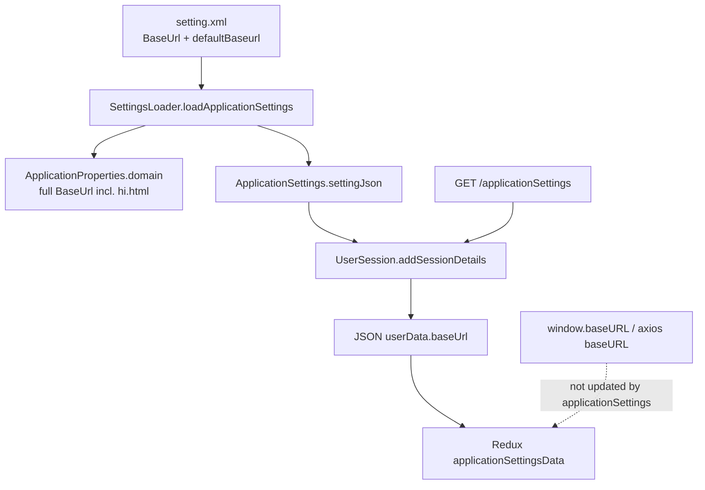
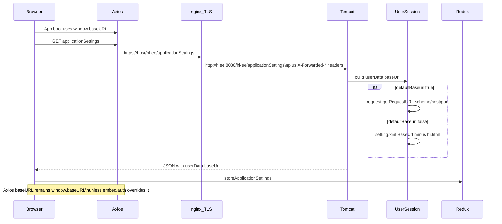
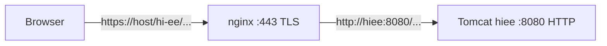
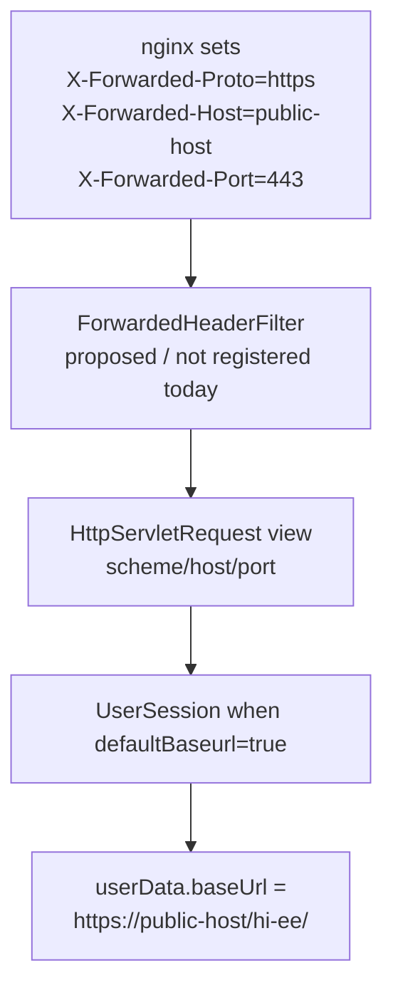

# BaseUrl Transition, Nginx TLS Termination, and Forwarded Headers

## Overview and Scope

This document explains how Helical Insight resolves the application **BaseUrl**, how that value changes around the `applicationSettings` call, how **nginx** participates in Docker deployments, and how Spring’s **`ForwardedHeaderFilter`** relates to correct public URL derivation behind a reverse proxy.

**Problem it solves:** The app must know a public-facing base URL for browser links, session payload fields, and server-side callbacks (export, scheduling). In Docker, TLS usually terminates at nginx while Tomcat serves plain HTTP on port `8080`. Without careful configuration, request-derived URLs become `http://hiee:8080/...` instead of `https://<host>/hi-ee/...`.

**Intended consumers:** Backend and frontend engineers changing BaseUrl behavior, proxy configuration, or bootstrap/login flow.

**Dependencies:**

| Layer | Role |
|-------|------|
| `setting.xml` | Configured `<BaseUrl>` and `<defaultBaseurl>` |
| `SettingsLoader` / `ApplicationProperties` | Server-side domain used by jobs |
| `GET/POST /applicationSettings` | Returns `userData.baseUrl` to the SPA |
| Client `window.baseURL` | Axios and deep-link base before/independent of settings |
| nginx (Docker) | TLS termination and `X-Forwarded-*` headers |

**Non-goals / verified limitations:**

- This document does **not** claim that `ForwardedHeaderFilter` or Tomcat `RemoteIpValve` are currently registered. Repository inspection of `web.xml` and Spring filter beans found neither. Sections that describe the filter explain **how it would help** if added.
- Client axios does **not** currently adopt `userData.baseUrl` from `applicationSettings`; it continues to use `window.baseURL` (or an embed `baseURL` prop).

---

## Architecture and Component Design

### Configuration sources



### Two different “base URL” concepts

| Concept | Source | Typical consumers |
|---------|--------|-------------------|
| **Configured BaseUrl** | `<BaseUrl>` in `setting.xml` → `ApplicationProperties.getDomain()` | Scheduling, export/phantom, other server-side HTTP to the app |
| **Session `userData.baseUrl`** | Computed in `UserSession` when serving `applicationSettings` | Stored in Redux as part of settings payload |
| **Client HTTP base** | `window.baseURL` from `index.html` (or embed prop) | Axios instance, many navigation URLs |

These are related but not automatically kept in sync by the client.

### What `BaseUrl` and `defaultBaseurl` do (`true` / `false`)

Configuration lives in `setting.xml`:

```xml
<BaseUrl>https://host/hi-ee/hi.html</BaseUrl>
<defaultBaseurl>false</defaultBaseurl>
```

| Setting | Type | Role |
|---------|------|------|
| **`BaseUrl`** | URL string | Canonical application URL. Loaded into `ApplicationProperties.domain` for schedules/exports. Also the source for `userData.baseUrl` when `defaultBaseurl` is **false**. |
| **`defaultBaseurl`** | Boolean | Controls **how** `UserSession` builds `userData.baseUrl` for `/applicationSettings`. If the key is **missing**, `UserSession` treats it as **`true`** (`optBooleanValue(..., true)`). |

#### `defaultBaseurl = true`

| Aspect | Behavior |
|--------|----------|
| Computation | `request.getRequestURL()` truncated to origin + `request.getContextPath()` + `"/"` |
| Uses `<BaseUrl>` for session field? | **No** |
| Code path | [`UserSession.java`](../core/src/main/java/com/helicalinsight/efw/controller/UserSession.java) — `if (defaultBaseurl)` branch |
| Healthy example (direct Tomcat) | Request `http://localhost:8085/hi-ee/applicationSettings` → `userData.baseUrl` = `http://localhost:8085/hi-ee/` |
| Failure mode behind nginx (no forwarded-header rewrite) | Request seen as `http://hiee:8080/...` → `userData.baseUrl` = `http://hiee:8080/hi-ee/` |
| Interaction with nginx | Needs `ForwardedHeaderFilter` (or equivalent) for public HTTPS scheme/host/port to appear on `HttpServletRequest` |
| `ApplicationProperties.domain` | Still set from `<BaseUrl>` at boot — **unchanged** by this flag |

#### `defaultBaseurl = false`

| Aspect | Behavior |
|--------|----------|
| Computation | `settingJson.BaseUrl` with `"hi.html"` removed |
| Uses `<BaseUrl>` for session field? | **Yes** |
| Code path | `UserSession` — `else` branch |
| Example | `<BaseUrl>https://host/hi-ee/hi.html</BaseUrl>` → `userData.baseUrl` = `https://host/hi-ee/` |
| Behind nginx | Public URL is correct **if** `<BaseUrl>` is the public HTTPS URL (Docker entrypoint pattern) |
| Interaction with nginx / ForwardedHeaderFilter | Not required for `userData.baseUrl`; filter may still matter for other request-derived URLs |
| `ApplicationProperties.domain` | Same `<BaseUrl>` string (including `hi.html`) for jobs |

#### Comparison

| | `defaultBaseurl = true` | `defaultBaseurl = false` |
|--|-------------------------|--------------------------|
| Source of `userData.baseUrl` | Live `HttpServletRequest` | Configured `<BaseUrl>` (strip `hi.html`) |
| Depends on proxy-visible scheme/host? | **Yes** | **No** |
| Typical Docker / TLS-at-nginx choice | Risky without forwarded-header handling | **Recommended** |
| Default if XML key omitted | **true** (in `UserSession`) | — |

---

## BaseUrl transition: before and after `applicationSettings`

### Before `applicationSettings`

1. **Server boot** loads `setting.xml` via `SettingsLoader.loadApplicationSettings()` and sets:

   ```text
   ApplicationProperties.domain = <BaseUrl>   // e.g. http://localhost:8085/hi-ee/hi.html
   ```

   Source: [`SettingsLoader.java`](../core/src/main/java/com/helicalinsight/admin/management/SettingsLoader.java) (`setDomain` from `BaseUrl`).

2. **Browser loads the SPA shell.** In local CRA / packaged HTML, the script tag sets the client HTTP base **before any API call**:

   ```html
   <!-- client/public/index.html -->
   <script>window.baseURL = "http://localhost:3000/hi-ee/"</script>
   ```

3. **Axios is constructed** from `window.baseURL` (or auth embed `baseURL`) in [`helperMethods.js`](../../client/src/app/helperMethods.js) / [`HiAxios.js`](../../client/src/app/HiAxios.js). Relative calls such as `GET applicationSettings` resolve against that base.

At this point the SPA already has a working API base, but Redux does **not** yet contain `userData.baseUrl`.

### Calling `applicationSettings`

| Property | Value |
|----------|--------|
| Method | `GET` or `POST` |
| Path | `/applicationSettings` (context path `/hi-ee`) |
| Auth | `permitAll` in Spring Security |
| Entry | [`EFWController.getApplicationSettings`](../core/src/main/java/com/helicalinsight/efw/controller/EFWController.java) |
| Session build | `UserSession.addSessionDetails("getContents", request, userData)` |

Client trigger: [`applicationSettings`](../../client/src/base/service.js) → [`applicationSettingsCheckLayer`](../../client/src/customHooks/applicationSettingsCheckLayer.js) → `storeApplicationSettings(data)`.

### How `userData.baseUrl` is computed

See [What `BaseUrl` and `defaultBaseurl` do](#what-baseurl-and-defaultbaseurl-do-true--false) for the full `true` / `false` behavior. Implementation in [`UserSession.java`](../core/src/main/java/com/helicalinsight/efw/controller/UserSession.java):

```java
if (GsonUtility.optBooleanValue(settingJson, "defaultBaseurl", true)) {
    // true → from request.getRequestURL() + contextPath
} else {
    // false → BaseUrl with "hi.html" removed
}
responseJson.addProperty("baseUrl", baseURL);
```

### After `applicationSettings`



**After the call:**

- Redux `applicationSettingsData.userData.baseUrl` holds the server-computed value.
- Login routing and feature flags from the same payload are applied.
- **Axios / `window.baseURL` are not rewritten** from `userData.baseUrl` in the current client code.

### Illustrative values (Docker behind nginx, `defaultBaseurl=false`)

| Stage | Value |
|-------|--------|
| Before API | `window.baseURL` = packaged or host-specific client base |
| `setting.xml` BaseUrl (Docker entrypoint) | `https://<HOST_IP>/hi-ee/hi.html` |
| After `applicationSettings` → `userData.baseUrl` | `https://<HOST_IP>/hi-ee/` |
| Tomcat internal request URL (if inspected) | Typically `http://hiee:8080/hi-ee/applicationSettings` |

With **`defaultBaseurl=true`** and **no** forwarded-header processing, `userData.baseUrl` would incorrectly become something like `http://hiee:8080/hi-ee/` because that is what `request.getRequestURL()` sees on Tomcat.

---

## How nginx works with BaseUrl

### Topology (Docker)



Config: [`docker/config/nginx/nginx.conf`](../../docker/config/nginx/nginx.conf).

- Listens on **443** with TLS certs under `docker/config/nginx/ssl/`.
- Proxies to upstream `hiee:8080` over **HTTP**.
- Application BaseUrl in Docker is expected to be the **public** HTTPS URL (written into `setting.xml` by the container entrypoint), not the internal Tomcat URL.

### Headers nginx sets

For the main `/` location (and similarly under `/hi-ee/ai/`):

| Header | Typical value | Intent |
|--------|---------------|--------|
| `X-Real-IP` | client address | Original client IP |
| `X-Forwarded-For` | proxy chain | Client IP chain |
| `X-Forwarded-Proto` | `https` | External scheme (TLS terminated here) |
| `X-Forwarded-Port` | `443` | External port |
| `Host` / `X-Forwarded-Host` | public host | External host name |
| `HTTPS` | `on` | Legacy/alternate HTTPS signal |

These headers describe the **browser-facing** request. Tomcat still receives an HTTP request on `8080` unless something in the servlet container or Spring rewrites the request view.

### Why Docker usually sets `defaultBaseurl=false`

With TLS at nginx and HTTP to Tomcat:

- Request-derived BaseUrl (`defaultBaseurl=true`) uses Tomcat’s view of the request unless forwarded headers are applied.
- Configured BaseUrl (`defaultBaseurl=false`) plus entrypoint rewrite to `https://${HOST_IP}/hi-ee/hi.html` makes `userData.baseUrl` and `ApplicationProperties.domain` match the public URL **without** depending on proxy-header consumption.

Server-side jobs that call `ApplicationProperties.getDomain()` also rely on that configured public BaseUrl being reachable from inside the container network (or from the host, depending on `HOST_IP`).

---

## How `ForwardedHeaderFilter` helps (design / gap analysis)

### Verified current state

Inspection of [`web.xml`](../presentation/src/main/webapp/WEB-INF/web.xml) shows filters such as encoding, CORS, Spring Security, validation, multipart, etc. There is **no** registration of:

- `org.springframework.web.filter.ForwardedHeaderFilter`
- Tomcat `RemoteIpValve` / `RemoteIpFilter` in the checked Docker `server.xml`

Therefore nginx’s `X-Forwarded-*` headers are **set** but are **not** currently used by Spring to rewrite `HttpServletRequest.getScheme()`, `getServerName()`, `getServerPort()`, or `getRequestURL()`.

### What the filter does (Spring)

`ForwardedHeaderFilter` wraps the incoming request so that methods like:

- `getScheme()`
- `getServerName()`
- `getServerPort()`
- `getRequestURL()`

reflect the **external** values from trusted `Forwarded` / `X-Forwarded-*` headers instead of the internal proxy hop.

### How that interacts with BaseUrl



| Mode | Without filter (today) | With filter (proposed) |
|------|------------------------|-------------------------|
| `defaultBaseurl=true` behind nginx | `request.getRequestURL()` ≈ `http://hiee:8080/...` → wrong public BaseUrl | Same API uses rewritten request → `https://public-host/hi-ee/` |
| `defaultBaseurl=false` | Uses configured `<BaseUrl>`; nginx headers irrelevant for this field | Still uses configured BaseUrl; filter optional for other request-derived URLs (SAML metadata, templates, audits) |

### Why it matters beyond `applicationSettings`

Other code paths also call `request.getRequestURL()` or build URLs from scheme/host/port (for example email template replacement and some auth/metadata helpers). Those benefit from the same request wrapping when the app is behind TLS-terminating nginx and you want request-derived public URLs without hardcoding `<BaseUrl>`.

### Security note

If `ForwardedHeaderFilter` (or `RemoteIpValve`) is introduced:

- Only trust headers from the known reverse proxy (nginx).
- Do not expose Tomcat directly to the internet while trusting arbitrary client-supplied `X-Forwarded-*` headers (header spoofing can alter perceived scheme/host).

Exact registration and trust settings are **[Confirm filter registration and trusted proxies]** until implemented.

---

## Configuration and Environment

### `setting.xml`

| Key | Required | Purpose | Example |
|-----|----------|---------|---------|
| `BaseUrl` | Yes for `defaultBaseurl=false` | Canonical app URL including `hi.html` | `https://host/hi-ee/hi.html` |
| `defaultBaseurl` | No (defaults to `true` in `UserSession` if missing) | `true` = derive from request; `false` = use configured BaseUrl | `false` |

### Docker

- Entrypoint rewrites `<BaseUrl>` from `HOST_IP` (and related env) into `setting.xml` at container start.
- nginx publishes host HTTPS (default port `443`) and proxies to `hiee:8080`.
- Client packaged with the WAR is typically served under the same public host via nginx.

### Local CRA development

- `window.baseURL` often points at the webpack dev server path (see `index.html`).
- `package.json` `"proxy"` may forward API calls to a local Tomcat port.
- `applicationSettings` still returns `userData.baseUrl` per `defaultBaseurl` / `BaseUrl` on that Tomcat.

---

## Troubleshooting

| Symptom | Likely cause | What to check |
|---------|--------------|---------------|
| `userData.baseUrl` is `http://hiee:8080/hi-ee/` | `defaultBaseurl=true` and request not rewritten | Set `defaultBaseurl=false` and public `BaseUrl`, **or** add trusted forwarded-header handling |
| Export/schedule hits wrong host | `ApplicationProperties.domain` / `<BaseUrl>` wrong | Entrypoint logs, `setting.xml`, `HOST_IP` |
| Browser calls wrong API host | `window.baseURL` wrong | Packaged `index.html` / embed `baseURL`; remember settings `baseUrl` does not update axios |
| HTTPS in browser but HTTP links in payload | Proxy headers ignored while deriving from request | Same as first row |
| Works on host:8080 but not via https://host | Topology mismatch: BaseUrl still HTTP or missing nginx | nginx health, BaseUrl scheme, certs |

---

## Design Decisions and Limitations

1. **Configured BaseUrl is the Docker safety default.** With TLS at nginx and no forwarded-header filter, `defaultBaseurl=false` plus a public `BaseUrl` is the supported way to keep session and job URLs correct.
2. **Client axios base is independent of `userData.baseUrl`.** Changing only `setting.xml` does not automatically retarget the SPA’s HTTP client.
3. **`ForwardedHeaderFilter` is the natural complement to nginx’s headers** for `defaultBaseurl=true` and other request-derived absolute URLs, but it is **not registered in the current tree**. Treat enablement as a separate engineering change with proxy-trust configuration.
4. **Server jobs use `ApplicationProperties.domain` (full BaseUrl including `hi.html` semantics as stored),** not the stripped `userData.baseUrl` form.

---

## Related References

| Artifact | Path |
|----------|------|
| BaseUrl computation | [`server/core/.../UserSession.java`](../core/src/main/java/com/helicalinsight/efw/controller/UserSession.java) |
| `applicationSettings` endpoint | [`server/core/.../EFWController.java`](../core/src/main/java/com/helicalinsight/efw/controller/EFWController.java) |
| Settings load / domain | [`server/core/.../SettingsLoader.java`](../core/src/main/java/com/helicalinsight/admin/management/SettingsLoader.java) |
| Settings file | [`server/hi-repository/System/Admin/setting.xml`](../hi-repository/System/Admin/setting.xml) |
| Client settings fetch | [`client/src/base/service.js`](../../client/src/base/service.js), [`applicationSettingsCheckLayer.js`](../../client/src/customHooks/applicationSettingsCheckLayer.js) |
| Client axios base | [`client/src/app/helperMethods.js`](../../client/src/app/helperMethods.js), [`client/public/index.html`](../../client/public/index.html) |
| nginx proxy | [`docker/config/nginx/nginx.conf`](../../docker/config/nginx/nginx.conf) |
| Filter chain | [`server/presentation/.../web.xml`](../presentation/src/main/webapp/WEB-INF/web.xml) |
| Spring `ForwardedHeaderFilter` (framework) | `org.springframework.web.filter.ForwardedHeaderFilter` (not registered here today) |
