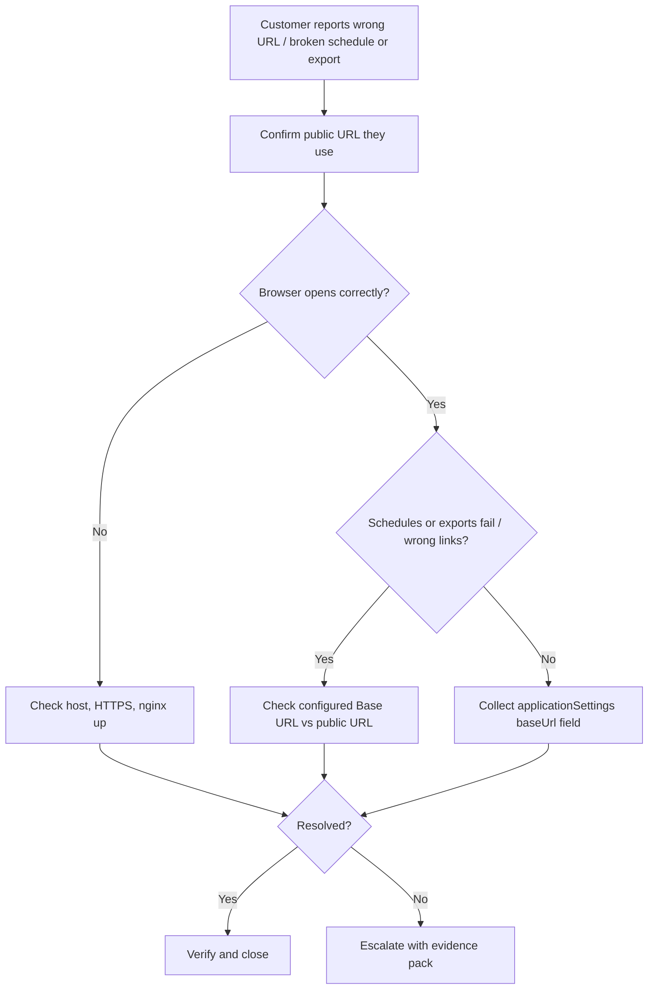

# Base URL Issues — Service Team Runbook

## Purpose and Scope

This runbook helps **customer support, application support, and operations** diagnose problems related to the Helical Insight **Base URL** (the public address of the application).

Use this guide when customers report:

- The app opens on the wrong host, port, or `http` vs `https`
- Scheduled reports, emails, or exports fail or link to the wrong address
- Login or navigation works in the browser, but background jobs do not
- Issues after moving from HTTP to HTTPS or after a Docker / nginx change

**Out of scope:** Changing product source code, redesigning nginx, or enabling server filters without engineering approval. Escalate those items.

**Related docs:**

- Engineering detail: [baseurl-config-document-engineer.md](baseurl-config-document-engineer.md)
- End-user / admin overview: [baseurl-config-document-enduser.md](baseurl-config-document-enduser.md)

---

## Before You Start

Collect:

- Customer environment (Docker package, WAR install, or other)
- The **exact URL** the customer types in the browser
- Whether they use **HTTPS / nginx** (typical for Docker)
- When the issue started (after upgrade, host rename, SSL enablement, etc.)
- Whether the problem affects **browser only**, **schedules/exports only**, or **both**
- Customer confirmation before any configuration change

**Risk labels used below:**

| Label | Meaning |
|-------|---------|
| Read-only | Safe diagnostic check |
| State-changing | Updates configuration or restarts services — needs authorization |
| Escalation | Stop and hand to engineering |

Do not ask customers to paste passwords, private keys, or full certificate files into tickets.

---

## Quick Triage



1. Confirm the symptom and the public URL the customer expects.
2. Ask whether **one user**, **one environment**, or **many users** are affected.
3. Separate **UI access** problems from **schedule/export** problems.
4. Compare the browser URL with the configured Base URL (see checks below).
5. If the case matches a known pattern in this runbook, follow that resolution.
6. If not, collect the evidence pack and escalate.

---

## How Base URL Works (Service View)

You do not need the full architecture. These ideas are enough for support.

### What `BaseUrl` and `defaultBaseurl` do

| Setting | Role |
|---------|------|
| **`BaseUrl`** | Saved public application address (e.g. `https://customer-host/hi-ee/hi.html`). Always loaded for server-side jobs (schedules, exports). Also used for `userData.baseUrl` when `defaultBaseurl` is **false**. |
| **`defaultBaseurl`** | Boolean switch that controls **only** how `userData.baseUrl` is built in the `applicationSettings` response. |

#### When `defaultBaseurl` is **true**

| Item | Behavior |
|------|----------|
| What happens | Server builds `userData.baseUrl` from the **current HTTP request** (scheme/host/port as the app server sees it) + context path |
| Uses saved `BaseUrl` for that field? | **No** |
| Typical healthy result | Matches the public URL **only if** the app sees the public request (direct access, or forwarded headers applied) |
| Typical broken result behind nginx | `http://hiee:8080/hi-ee/` or similar internal/HTTP value |
| Support action | Prefer switching to **false** + correct public `BaseUrl`; escalate if customer requires request-derived mode |

#### When `defaultBaseurl` is **false** (common / recommended with Docker HTTPS)

| Item | Behavior |
|------|----------|
| What happens | Server sets `userData.baseUrl` from saved **`BaseUrl`**, with `hi.html` removed |
| Uses saved `BaseUrl` for that field? | **Yes** |
| Example | `BaseUrl` = `https://host/hi-ee/hi.html` → `userData.baseUrl` = `https://host/hi-ee/` |
| Jobs / schedules | Still use the full saved `BaseUrl` / domain — must be the public reachable address |
| Support action | If links/jobs are wrong, fix **`BaseUrl`** (and Docker host), not the browser bookmark alone |

#### Side-by-side

| | `defaultBaseurl = true` | `defaultBaseurl = false` |
|--|-------------------------|--------------------------|
| Source of `userData.baseUrl` | Current request | Configured `BaseUrl` (strip `hi.html`) |
| Sensitive to nginx/internal hop? | **Yes** | **No** (as long as `BaseUrl` is correct) |
| Needs ForwardedHeaderFilter for HTTPS proxy? | Helpful / often required | Not required for this field |
| Usual Docker advice | Avoid unless engineering enabled forwarded headers | **Preferred** |

### Browser starting address

When the page first loads, the browser already has a starting address so it can call the server. That value is **not** automatically rewritten when settings return.

### Value returned by `applicationSettings`

During startup/login, the product calls:

`GET` or `POST` `/hi-ee/applicationSettings`

The response includes `userData.baseUrl`, computed per **`defaultBaseurl` true/false** above.

**Important for support:** Wrong internal values (for example `http://hiee:8080/hi-ee/`) usually mean `defaultBaseurl=true` behind nginx without proper public URL handling.

### Before vs after `applicationSettings`

| Moment | What support should know |
|--------|---------------------------|
| **Before** | Page can already call the API using its starting address; server already has configured `BaseUrl` for jobs |
| **During** | Automatic `applicationSettings` call runs (customer does not click a special button) |
| **After** | UI stores settings including `userData.baseUrl`; schedules/exports still depend on configured `BaseUrl` |

If browser works but jobs fail, focus on **configured Base URL**, not only what the browser shows.

---

## How nginx Fits In

In the Docker package, typical flow:

```text
Customer browser  →  HTTPS (nginx)  →  Helical Insight (internal HTTP)
```

- Customers should open the **nginx HTTPS** address (often `https://host` without an app port).
- nginx can add **forwarded headers** (`X-Forwarded-Proto`, `X-Forwarded-Port`, `Host`, and related fields) describing the public HTTPS request.
- The application behind nginx still receives an internal HTTP hop unless configuration (or a filter) maps that to the public URL.

**Support implication:** After enabling HTTPS or nginx, if Base URL was left as an old `http://host:8080/...` value, schedules and exports often break even when the UI seems fine.

---

## How ForwardedHeaderFilter Helps (What to Tell Engineering)

**Forwarded headers** are notes from nginx (“user used HTTPS on 443 at this host”).

**ForwardedHeaderFilter** is a server component that can make the application trust those notes when building URLs from the current request (`defaultBaseurl=true`).

| Fact for service teams | Detail |
|------------------------|--------|
| Current product (verified in repo) | `ForwardedHeaderFilter` is **not** registered in the standard filter chain |
| Usual supported approach | Set **public** `BaseUrl` and keep `defaultBaseurl=false` |
| When to mention the filter | Only when escalating a case where the customer insists on request-derived Base URL behind nginx |

Do **not** tell the customer to “enable ForwardedHeaderFilter” as a self-service fix. That is an engineering change.

---

## API Usage for Service Teams

### Inspect Base URL via `applicationSettings`

**Purpose:** Confirm what base URL the server returns to the browser session.

**Classification:** Read-only when used as a GET/POST that only retrieves settings.

**Before calling**

- Use a browser session on the customer’s public URL, or an authorized support session.
- Prefer the same URL the customer uses (`https://...` through nginx when applicable).

**Request**

```http
GET /hi-ee/applicationSettings
Accept: application/json
```

(Also accepted as `POST` on the same path.)

Cookie/session authentication applies when the user is logged in; the endpoint is configured to allow unauthenticated access for bootstrap, but logged-in responses include richer user data.

**Response fields to inspect**

| Field | What to look for |
|-------|------------------|
| `userData.baseUrl` | Should match the **public** site prefix (scheme + host + `/hi-ee/`) |
| Other settings | Only as needed; do not dump full payloads into public tickets |

**Interpretation**

| Observed `userData.baseUrl` | Likely meaning | Next action |
|-----------------------------|----------------|-------------|
| `https://<customer-host>/hi-ee/` | Matches public HTTPS entry | If jobs still fail, check configured `BaseUrl` / `HOST_IP` separately |
| `http://<host>:8080/hi-ee/` | Pointing at direct app port | Ask whether nginx/HTTPS should be used; align Base URL |
| `http://hiee:8080/hi-ee/` or similar internal name | Request-derived URL behind Docker network | Treat as Base URL misconfiguration; escalate if settings look correct |
| `http://...` while users use `https://...` | Scheme mismatch | Update configured Base URL to HTTPS (authorized change) |

**Safety**

- Do not paste full settings JSON with tokens or personal data into tickets.
- Sanitize hostnames if required by customer policy.
- Do not change `setting.xml` or restart containers without authorization.

---

## Symptoms, Causes, and Resolution

### 1. Customer must use `:8080` or an HTTP URL after “HTTPS was enabled”

**Impact:** Confusing access; mixed content or bookmark issues.

**Possible causes (diagnostic):**

- Opening Tomcat directly instead of nginx
- nginx not running or not healthy
- DNS/firewall blocking 443

**Checks (read-only):**

1. Ask for the exact URL that works and the URL that fails.
2. Confirm whether Docker nginx container/service is up ([Confirm customer’s monitoring method]).
3. Compare with the documented Docker entry URL (`https://...` when nginx is used).

**Resolution (state-changing, needs approval):**

1. Direct users to the HTTPS nginx URL.
2. If nginx is down, follow the approved restart procedure for that environment.
3. Update Base URL / host settings if they still reference `:8080`.

**Verification:** Customer opens the app on the public HTTPS URL and signs in.

**Escalate when:** nginx will not stay healthy, certificates fail, or port 443 cannot be bound.

---

### 2. Browser works; schedules, emails, or exports fail

**Impact:** Automated delivery broken; UI may look healthy.

**Possible causes (diagnostic):**

- Configured `BaseUrl` still uses old host, port, or `http`
- Docker `HOST_IP` / Base URL rewrite does not match the public hostname
- Internal hostname in Base URL not reachable from job runtime

**Checks (read-only):**

1. Confirm browser URL (public).
2. Inspect `userData.baseUrl` via `applicationSettings` from that same URL.
3. Ask ops/admin for the stored `BaseUrl` value (not a screenshot of secrets).
4. Reproduce one small export/schedule if authorized.

**Resolution (state-changing, needs approval):**

1. Set configured Base URL to the public address (including correct `https`).
2. For Docker, correct host-related env and redeploy/restart per runbook.
3. Retest one schedule/export.

**Verification:** Job completes; links in output/email use the public URL.

**Escalate when:** Base URL looks correct but jobs still fail (may be Chrome/export, network, or license — not Base URL alone).

---

### 3. `userData.baseUrl` shows internal Docker name (`hiee`, etc.)

**Impact:** Wrong links in session-related behavior; jobs may also fail.

**Possible causes (diagnostic):**

- `defaultBaseurl=true` while traffic is proxied through nginx
- Forwarded headers present but not consumed (no `ForwardedHeaderFilter` today)

**Checks (read-only):**

1. Capture sanitized `userData.baseUrl`.
2. Confirm access path (via nginx HTTPS vs direct 8080).
3. Ask whether `defaultBaseurl` is true or false.

**Resolution (state-changing, needs approval):**

1. Preferred: set `defaultBaseurl=false` and public `BaseUrl`.
2. Do not instruct the customer to enable `ForwardedHeaderFilter` themselves.

**Verification:** `applicationSettings` returns public `https://.../hi-ee/`.

**Escalate when:** Customer requires request-derived Base URL behind the proxy — engineering must evaluate forwarded-header support.

---

### 4. Mixed HTTP/HTTPS after migration

**Impact:** Broken redirects, failed callbacks, browser warnings.

**Checks:** Browser URL scheme vs configured Base URL scheme vs `userData.baseUrl` scheme.

**Resolution:** Align all three to the approved public scheme (usually HTTPS). Restart/redeploy if required by the environment.

**Escalate when:** Certificate or load-balancer configuration is outside Helical Insight settings.

---

## Incident Handling and Escalation

Escalate to engineering when:

- Base URL and nginx appear correct, but jobs or login still fail
- Customer needs request-derived Base URL behind TLS termination
- Certificate, port binding, or proxy trust issues persist
- You suspect a product defect rather than misconfiguration

**Evidence pack (attach sanitized copies):**

| Field | Example |
|-------|---------|
| Public URL used | `https://analytics.example.com/hi-ee/` |
| Environment | Docker / WAR / other |
| nginx/HTTPS in use? | Yes / No |
| `userData.baseUrl` | `https://analytics.example.com/hi-ee/` |
| Configured `BaseUrl` (sanitized) | `https://analytics.example.com/hi-ee/hi.html` |
| `defaultBaseurl` | `true` / `false` |
| Symptom start time | Date/time + timezone |
| Browser vs jobs impact | Browser only / Jobs only / Both |
| Actions already tried | List |
| Relevant logs (sanitized) | Container or app logs around failure |

---

## Customer Communication

### Initial acknowledgement

> Thank you for reporting this. We are checking how the application base address is configured in your environment and will confirm whether the browser URL and the server Base URL are aligned. We will update you when we have the next findings.

### After identifying a configuration mismatch

> We found that the address used in the browser does not match the Base URL stored for background tasks (schedules/exports). With your approval, we will update the Base URL to your public HTTPS address and retest a sample job.

### When escalating

> We have completed the standard Base URL checks (public URL, application settings response, and configured Base URL). The issue needs a deeper review by our product engineering team. We are escalating with the diagnostic details and will share updates as we receive them.

Avoid promising that enabling `ForwardedHeaderFilter` will fix the issue unless engineering confirms that plan.

---

## Resolution and Closure

1. Confirm the original symptom is gone (access and/or jobs).
2. Re-check `userData.baseUrl` and, if relevant, one schedule/export.
3. Tell the customer what was changed (host/scheme/Base URL) without exposing internal-only details.
4. Record root cause category: misconfigured Base URL, nginx/HTTPS path, migration leftover, or escalated defect.
5. Close per your organization’s ticket process.

---

## Frequently Asked Questions

**Why does the UI work but email/schedule links are wrong?**  
The browser can use one address while server jobs use the configured Base URL. Align the stored Base URL with the public HTTPS URL.

**What is `applicationSettings`?**  
An automatic startup/login call that returns configuration, including `userData.baseUrl`. Customers do not normally invoke it manually.

**Should I tell the customer to enable ForwardedHeaderFilter?**  
No. That is not a self-service setting in the current product. Escalate if request-derived URLs behind nginx are required.

**Is it safe to retry `applicationSettings`?**  
Yes for diagnosis (read-oriented). It does not replace fixing Base URL configuration.

**What if Docker `HOST_IP` is wrong?**  
Jobs and returned Base URL can point at an unreachable or incorrect host. Correct the host value with an authorized change, then restart/redeploy per the Docker runbook.

---

## Related References

| Document | Audience |
|----------|----------|
| [baseurl-config-document-engineer.md](baseurl-config-document-engineer.md) | Engineering |
| [baseurl-config-document-enduser.md](baseurl-config-document-enduser.md) | Admins / operators |
| [Docker readme](../../docker/readme/readme.md) | Deployment |
| [HTTPS port change](../../docker/readme/portchange.md) | Deployment |
