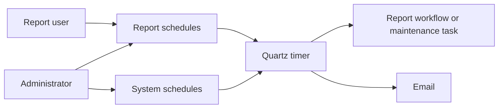
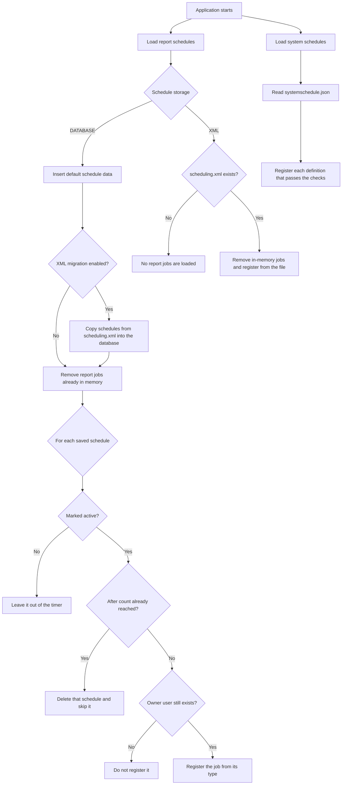
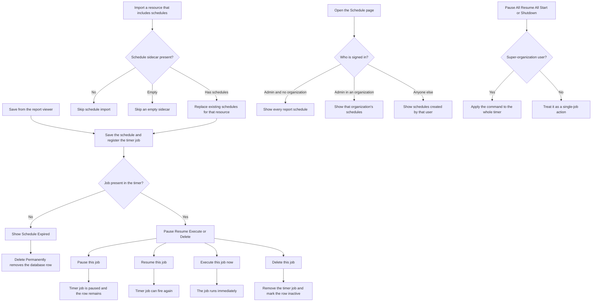
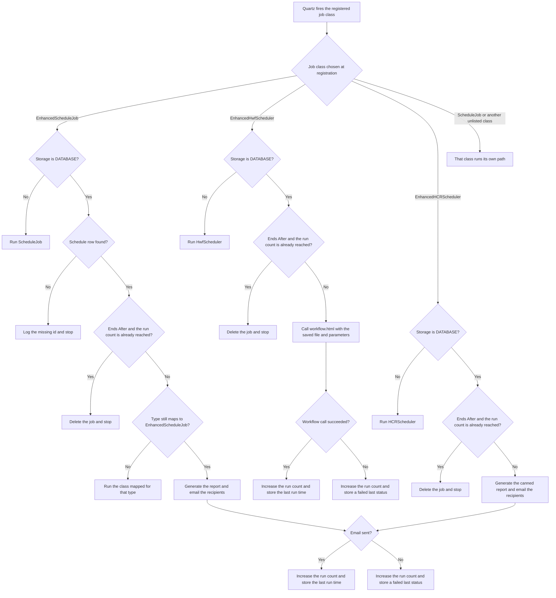
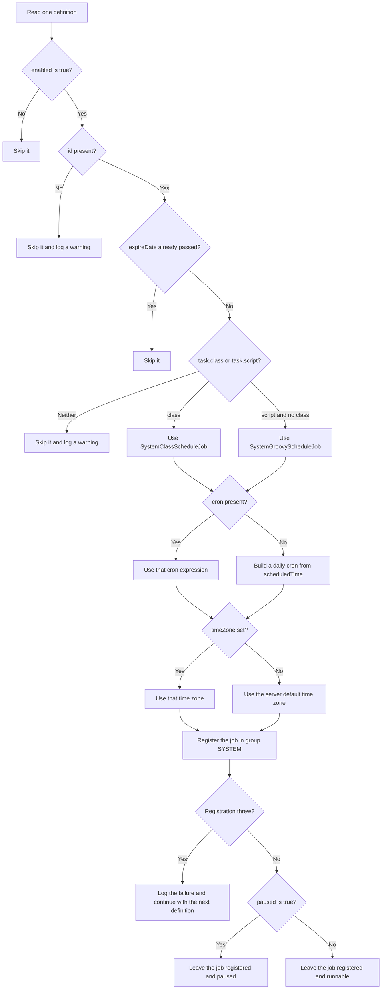
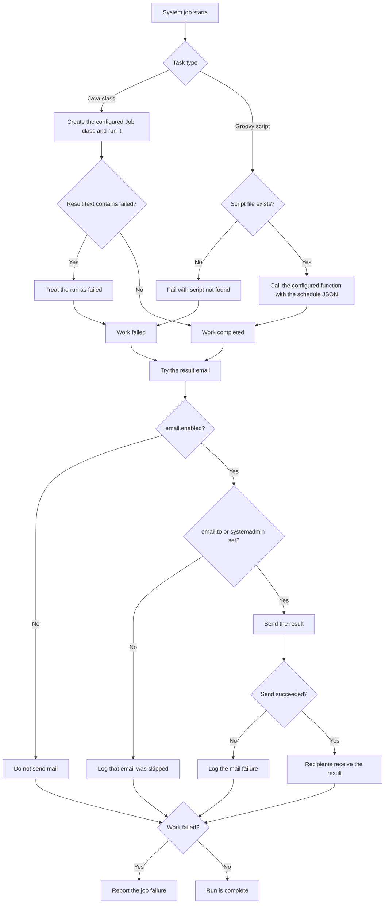
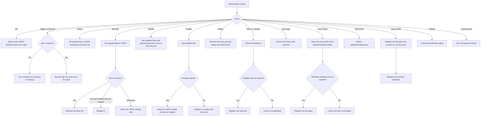

# How Schedule Works

Scheduling runs work at a chosen time and, when email is configured, sends the result. Helical Insight keeps two kinds of schedules. Both use Quartz, the in-process timer that fires jobs.

| Reader | Start here |
| --- | --- |
| Managers and other stakeholders | Sections 1 to 3 |
| QA engineers | The diagrams, then [What QA can confirm](#what-qa-can-confirm) |
| Engineers | The diagrams, then [Engineer reference](#engineer-reference) |

## 1. What a schedule is

A schedule is a saved instruction: what to run, how often, when it stops, and who receives the result.

A person sets that instruction in the product. The application saves it, and Quartz holds a matching timer job in memory. When the time arrives, the job runs. After a restart, Quartz memory is empty, so startup reads the saved instructions and registers the jobs again.

The current Quartz setup stores jobs in memory. `server/presentation/src/main/resources/quartz.properties` leaves the database job-store settings commented out. The timer thread pool size is 10.

## 2. Two kinds of schedules

Report schedules belong to a report, dashboard, canned report, Helical report, or workflow. A user creates one from the report viewer. The result is usually an email with the generated file.

System schedules are maintenance jobs for the application, such as deleting old audit rows or cleaning a temp folder. An administrator manages them. They are defined in a JSON file, not as user reports.

Report schedules and system schedules do not share a list, a file, or a job group. The Schedule admin page can show either list. The System Schedules switch appears when the signed-in user has no organization.

Shipped system schedules in `server/hi-repository/System/Admin/SystemSchedule/systemschedule.json`:

| Schedule | What it does | How it runs | When | Email |
| --- | --- | --- | --- | --- |
| LLM Usage Audit Purge | Removes Instant BI usage audit records older than the retention period. It can export them first. | Java class | Daily at 00:05 | Enabled, recipient blank |
| Transfer Ticket Purge | Purges expired resumable download and upload tickets | Java class | Every 5 minutes (`0 0/5 * * * ?`) | Disabled |
| Temp Directory Clean | Deletes temp files older than the configured number of days | Groovy script `tempDirectoryClean.groovy`, function `execute` | Daily at 01:00 | Enabled, recipient blank |

A blank `email.to` still counts as enabled. Delivery then uses `systemadmin` from `System/Mail/mailConfiguration.properties`. If that address is also missing, the email is skipped.

## 3. What people do in the product

### Create a report schedule

In the report viewer, open Schedule. Choose how often it runs and when it ends, then save.

Frequency choices: Daily, Weekly, Monthly, Yearly.

End choices:

- Never: the schedule keeps its next run.
- On: the schedule stops on the chosen end date.
- After: the schedule stops after the chosen number of runs.

The saved schedule is stored with the report. While schedule storage is `DATABASE`, that store is the application database. `server/hi-repository/System/Admin/setting.xml` sets `ScheduleStorageType` to `DATABASE`.

### Manage report schedules

Administrators open the Schedule page. The list depends on who is signed in:

- An admin user with no organization sees every report schedule.
- An admin user inside an organization sees schedules created in that organization.
- Any other user sees schedules that user created.

On a live job the row offers Pause, Resume, Execute, and Delete. The page toolbar also offers Pause All, Resume All, Start, and Shutdown. The server runs those four toolbar actions only for a super-organization user.

### Manage system schedules

Turn on System Schedules. The toolbar offers Add, Edit, and Refresh. Edit opens the whole `systemschedule.json` file. Each row can offer Edit, Edit Script, Trigger Now, Pause, Resume, Disable, Enable, and Delete. Edit Script appears for a Groovy task. Trigger Now and Pause or Resume appear when the job is in the timer.

## 4. What happens at startup

Startup loads the two families separately. Report schedules are loaded by `InitializeScheduleData`. System schedules are loaded by `InitializeSystemScheduleData`, which calls `SystemScheduleLoader`.

`MigrateFromXMLSchedulingToDatabase` is `true` in the current `setting.xml`. Migration runs when storage is `DATABASE` and that flag is true. The setting comment says to place the existing `scheduling.xml` in `hi-repository/System` before restart when a migration is required.

System registration follows the decision tree in the next section. A failure to load system schedules is logged. It does not stop report schedules from loading.

## 5. Report schedule paths

### Create, list, and change a report schedule

A schedule can arrive from the report viewer or from a resource import. Import reads the schedule sidecar through `ScheduleHandler`, saves the rows, and registers each job.

Delete of a live job removes it from Quartz and sets the schedule inactive. The row stays. The screen then shows Schedule Expired, and Delete Permanently removes the database row. Startup registers only active schedules, so an inactive row is not put back into the timer.

The Schedule page also displays this warning: deleting a scheduled job is temporary, and the job may be rescheduled on restart when the end date is still in the future. Use the database behavior above when storage is `DATABASE`.

Pause All pauses every Quartz job, including system jobs, because it calls pause on the whole scheduler. Resume All resumes every job the same way. Start starts the scheduler. Shutdown puts the scheduler in standby unless the request sets force to true, in which case it shuts the scheduler down.

### What runs when a report job fires

The timer job class comes from `SchedulingJob.@type`. That value is the resource type name. `ScheduleJobFactory` matches it to a `<job type="...">` entry in `setting.xml`. The current entries are:

| Type | Screen label | Job class | What the run does |
| --- | --- | --- | --- |
| `efwdd` | Dashboard | `EnhancedScheduleJob` | Builds the report and emails it |
| `report` | Report | `EnhancedScheduleJob` | Builds the report and emails it |
| `hr` | Helical Report | `EnhancedScheduleJob` | Builds the report and emails it |
| `hwf` | Other | `EnhancedHwfScheduler` | Calls `workflow.html` for that workflow file |
| `hcr` | Canned Report | `EnhancedHCRScheduler` | Builds the canned report and emails it |

A type that is not in that list resolves to `com.helicalinsight.scheduling.ScheduleJob`. `HttpScheduleJob` and `EnhancedHttpScheduleJob` exist in the scheduling module. The active `setting.xml` does not list them.

`EnhancedScheduleJob` checks the stored type again at fire time. If that type now maps to a different class, it runs that class and returns. Dashboard, report, and Helical report types stay on the email path. A type that is unknown at registration is given the Quartz class `ScheduleJob`, so that fire does not enter the three enhanced branches.

Workflow runs do not use the report email step. They request `workflow.html`. Report and canned-report runs read mail settings from `System/Mail/mailConfiguration.properties` and send the message to the recipients saved on the schedule. A mail failure is logged, the run count still increases, and the last status is stored as failed.

## 6. System schedule paths

### Which definitions become timer jobs

`SystemScheduleLoader` reads `server/hi-repository/System/Admin/SystemSchedule/systemschedule.json`. The file must be a JSON array. A missing file or a root value that is not an array loads no system jobs.

`expireDate` may be `never`, blank, a positive epoch millisecond value, or `yyyy-MM-dd'T'HH:mm:ss`. `never`, blank, and a missing value mean the job does not expire. A value that does not match those forms is logged and treated as no expiry.

A Java `task.class` wins over `task.script` when both are present. A script is loaded only from the SystemSchedule folder, using the file name. The Groovy function defaults to `execute`.

System triggers use the Quartz misfire instruction do nothing. A missed fire is not run late.

Startup removes every existing job in the `SYSTEM` group before registering the file again. One definition is then added, replaced, or removed without reloading the others when an administrator saves, enables, disables, or deletes it.

### What happens on a system run

Both task types share one wrapper. The wrapper runs the work, then always attempts the notification email.

A mail problem does not hide a failed job, and a failed job still attempts the email. The email subject is `System Schedule:` plus the schedule id. The body contains the schedule id and the result text.

Trigger Now from the admin page runs the same job class immediately. It requires the job to already be in memory. It does not ask Quartz to fire the trigger.

### Administrator actions

Every system action is handled by `SystemScheduleManager`. Save and delete update `systemschedule.json` and the in-memory timer.

Available row buttons follow the same state:

- Edit and Delete are always offered.
- Edit Script is offered for a script task.
- Trigger, and either Pause or Resume, are offered when the job is in memory.
- Disable is offered when the job is enabled. Enable is offered when it is disabled.
- Reload is offered when the job is not expired.

## What QA can confirm

Use the Schedule page for report schedules, and the System Schedules switch for maintenance jobs. Confirm the stored record and the timer state. A successful HTTP response from an admin action is not enough on its own.

| Path | What you should see |
| --- | --- |
| Report list as admin with no organization | Every report schedule |
| Report list as an organization admin | Schedules created in that organization |
| Report list as a normal user | Only schedules that user created |
| Save Daily, Weekly, Monthly, or Yearly | A row whose frequency matches that choice |
| End Never | The job keeps a next fire time |
| End On | The job has an end at the chosen date |
| End After, count already reached | The job is deleted and does not run |
| Dashboard, Report, or Helical Report fires | Recipients receive the report email, or the last status is stored as failed |
| Workflow fires | `workflow.html` is called for the saved file. A failed call still increases the run count and stores a failed last status |
| Canned report fires | Recipients receive the canned-report email, or the last status is stored as failed |
| Pause one report job | That job's trigger state is paused |
| Resume one report job | That job can fire again |
| Execute one report job | The job runs without waiting for the next fire time |
| Delete a live report job | The timer job is gone and the row is inactive. Schedule Expired appears |
| Delete Permanently | The database row is gone |
| Pause All or Resume All as a super-organization user | The whole scheduler pauses or resumes |
| The same toolbar actions as another user | The server does not apply the scheduler-wide command |
| Restart | Active report schedules return. Inactive report schedules stay out of the timer. System jobs are rebuilt from `systemschedule.json` |
| System job disabled, missing id, expired, or missing class and script | It is absent from the `SYSTEM` timer group |
| System job paused | It is in memory and its trigger is paused |
| Java system task | The configured class runs |
| Groovy system task | The named script function runs. A missing file fails the run |
| System email enabled with a recipient or `systemadmin` | A result email is attempted after success and after failure |
| System email disabled, or no recipient and no `systemadmin` | No result email is sent |
| Trigger Now on a system job that is not in memory | The action fails and names the schedule |
| Disable a system job | `enabled` is false and the timer job is removed |
| Enable an expired system job | The JSON is enabled and the job stays unregistered |
| Delete a system job | The JSON entry and the timer job are both gone |

## Engineer reference

### Report schedules

| Item | Location |
| --- | --- |
| Create and update | `server/scheduling/src/main/java/com/helicalinsight/scheduling/SaveReportController.java`, `ScheduleController.java` |
| Startup | `server/scheduling/src/main/java/com/helicalinsight/scheduling/InitializeScheduleData.java` |
| Database registration | `server/scheduling/src/main/java/com/helicalinsight/scheduling/EnhancedScheduleProcessCall.java` |
| XML registration | `server/scheduling/src/main/java/com/helicalinsight/scheduling/ScheduleProcessCall.java` |
| List and row actions | `server/scheduling/src/main/java/com/helicalinsight/scheduling/EnhancedSchedulerActionHandler.java` |
| Pause, resume, delete, execute, and scheduler-wide commands | `server/scheduling/src/main/java/com/helicalinsight/scheduling/SchedulerActionHandler.java` |
| Type to class map | `server/hi-repository/System/Admin/setting.xml` `<schedule>` and `ScheduleJobFactory` |
| Cron from the viewer choices | `server/scheduling/src/main/java/com/helicalinsight/scheduling/ConvertIntoCronExpression.java` |
| Import and export | `server/scheduling/src/main/java/com/helicalinsight/scheduling/handler/ScheduleHandler.java` |
| Viewer choices | `client/src/components/hi-user-module/components/SchedulingOptions.jsx` |
| Admin page | `client/src/components/hi-admin/components/hi-scheduling/hi-scheduling.jsx` |

Storage is selected by `ScheduleStorageType` through `JsonUtils.newIsScheduleStorageTypeIsDatabase()`. The current value is `DATABASE`. The XML path reads `schedulerPath` from `server/presentation/src/main/resources/project.properties`.

Report jobs are registered in Quartz's default group. The job name is the schedule id.

`EnhancedHwfScheduler` checks storage with `JsonUtils.isScheduleStorageTypeIsDatabase()`. The dashboard, report, Helical report, and canned-report jobs use `newIsScheduleStorageTypeIsDatabase()`. Both methods are true when storage is `DATABASE`. When storage is XML, each enhanced job calls its parent: `ScheduleJob`, `HwfScheduler`, or `HCRScheduler`.

### System schedules

| Item | Location |
| --- | --- |
| Definitions | `server/hi-repository/System/Admin/SystemSchedule/systemschedule.json` |
| Startup | `server/scheduling/src/main/java/com/helicalinsight/scheduling/InitializeSystemScheduleData.java` |
| Register, skip, cron, and expiry | `server/scheduling/src/main/java/com/helicalinsight/scheduling/SystemScheduleLoader.java` |
| Admin actions | `server/scheduling/src/main/java/com/helicalinsight/scheduling/SystemScheduleManager.java` |
| Run wrapper and email attempt | `server/scheduling/src/main/java/com/helicalinsight/scheduling/SystemScheduleJob.java` |
| Java task | `server/scheduling/src/main/java/com/helicalinsight/scheduling/SystemClassScheduleJob.java` |
| Groovy task | `server/scheduling/src/main/java/com/helicalinsight/scheduling/SystemGroovyScheduleJob.java` |
| Email | `server/scheduling/src/main/java/com/helicalinsight/scheduling/SystemScheduleMailHelper.java` |
| Admin screen | `client/src/components/hi-admin/components/hi-scheduling/SystemScheduleActions.jsx` |

System jobs use Quartz group `SYSTEM`. Job data stores the schedule JSON as a string because the job store requires serializable values.

Actions and the store they change:

| Action | JSON file | Timer |
| --- | --- | --- |
| list, getScript | Read | Read |
| trigger, execute | Unchanged | Runs the in-memory job |
| pause | `paused` true | Pauses the job when it exists |
| resume | `paused` false | Resumes the job, or registers it when it is enabled and not expired |
| disable | `enabled` false and `paused` false | Removes the job |
| enable | `enabled` true | Registers it unless it is expired |
| delete | Removes the entry | Removes the job |
| save, update | Writes the entry | Registers it when enabled and not expired. Otherwise leaves it unregistered |
| saveScript | Writes the `.groovy` file | Registers again when that schedule is enabled and not expired |
| getJson | Read | Read |
| saveJson | Replaces the file when the content is a JSON array | Rebuilds the `SYSTEM` group |
| reload | Rereads the file | Rebuilds the `SYSTEM` group |

### Limits that are part of the current setup

- Quartz jobs live in memory. Restart rebuilds them from the database or from `systemschedule.json`.
- The JDBC Quartz job store in `quartz.properties` is commented out.
- HTTP schedule classes are in the source tree. The active `<schedule>` block does not reference them.
- XML schedule storage is the path used when `ScheduleStorageType` is not `DATABASE`.
- System misfires are not replayed.
- A report-schedule Pause All or Resume All acts on the whole scheduler.
